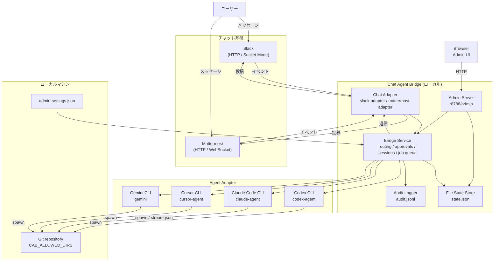

# Chat Agent Bridge

> このブランチでは WinUI 3 / C# ネイティブ版を開発しています。ビルド・起動手順は [desktop/README.ja.md](desktop/README.ja.md)、機能対応と進捗は [移行計画](docs/winui-migration-plan.ja.md) を参照してください。以下は移行元の TypeScript 版の説明です。

Windows用の単体実行ファイルに対応しています。`npm run package:exe` で生成した `release/ChatAgentBridge.exe` をダブルクリックし、表示された管理画面URLをブラウザーで開いてください。自動起動は `--open-browser` で指定できます。利用時のNode.js/npmは不要です。詳しくは [実行ファイル版の使い方](docs/executable.ja.md) を参照してください。

## 新しい接続管理画面

起動後の管理画面でエージェントとSlack/Mattermostを設定し、接続・切断できます。CodexはApp Serverに対応し、承認・追加入力を同じチャットスレッドから返せます。詳しくは [接続管理とハーネス](docs/harness-modernization.md) を参照してください。


- Languages: [English](README.md) / [Japanese](README.ja.md)

Chat Agent Bridge は、チャットスレッドからローカル PC 上の開発エージェントを継続操作するためのローカル bridge サービスです。

## このプロジェクトの位置づけ

このプロジェクトは、公式プロダクト側で安定したリモートコントロールセッション機能が整うまでの間に、個人開発用途で使うことを想定した非公式ツールです。

ローカル PC 上でのセルフホスト運用を前提としており、OpenAI、Anthropic、Slack、Mattermost、Cursor、Google の公式製品ではありません。

現状の実装は Windows 前提で、主に PowerShell を使う Windows 環境で開発・検証しています。

## できること

- チャットスレッドをローカル agent session に紐付ける
- 同じ PC 上の repository、未コミット変更、ローカルツール状態を維持したまま継続操作する
- スレッドの最初のメッセージから working directory を決定し、指定がなければ番号付きの repo picker を出す
- 紐付いた folder に過去の Claude Code session があれば、`~/.claude/projects` の実データから resume 候補を提示する
- チャンネルごとに既定の working directory を記憶する
- allowed directory root をチャットまたは Admin UI から実行時に追加・削除できる（再起動不要）
- Slack と Mattermost の chat adapter を使う
- Codex、Claude Code、Cursor、Gemini CLI の agent adapter を使う
- 承認フロー、監査ログ、repo 切り替え、Admin UI を提供する
- Mattermost の `bot` mode と `self` mode をサポートする

## クイックスタート

以下のコマンドは Windows + PowerShell を前提としています。

1. 依存をインストールします。

```powershell
npm install
npm run check
```

2. 最低限の環境変数を設定します。

```powershell
$env:CAB_ALLOWED_DIRS="$env:USERPROFILE\Documents\git"
$env:CAB_DEFAULT_WORKDIR="$env:USERPROFILE\Documents\git\chat-agent-bridge"
```

3. bridge を起動します。

```powershell
npm run dev
```

接続済みのチャットスレッドから `@Chat Agent Bridge status` を送ると疎通確認できます。

detached service として動かす場合:

```powershell
npm run service:start
npm run service:status
```

Windows ログオン時に bridge を自動起動する場合:

```powershell
npm run service:install-autostart
```

## 最初のメンションから始まる典型的な流れ

新しいスレッドの最初のメッセージで、どの working directory で動くかが決まります。典型的なやり取りは次のようになります。

```
あなた: @Chat Agent Bridge haruhi ログイン画面を直して
Bridge: This folder (`...\haruhi`) has previous Claude Code sessions. Reply with a number to resume, or `new` to start fresh. Your instruction will run after you choose.
        1. `a1b2c3d4` - fix login redirect loop (2026-07-01T09:12:00.000Z)
        2. `9f8e7d6c` - add MUI theme toggle (2026-06-28T14:03:00.000Z)
あなた: 1
Bridge: (session `a1b2c3d4` を `...\haruhi` で resume し、「ログイン画面を直して」を実行する)
```

最初のメッセージに alias や path がなければ、bridge が先に尋ねます。

```
あなた: @Chat Agent Bridge ログイン画面を直して
Bridge: Choose a working directory for this thread (allowed roots only). Reply with a number, or `keep` to stay on `...\chat-agent-bridge`.
        1. `haruhi` -> `...\haruhi`
        2. `inori` -> `...\inori`
あなた: 1
Bridge: (スレッドを `haruhi` に紐付け、必要なら Claude Code の resume picker を出したうえで「ログイン画面を直して」を実行する)
```

チャンネルごとに既定の working directory を設定しておくと、以降のスレッドで directory picker を省略できます: `@Chat Agent Bridge channel-default haruhi`

## デモ

Slack の例:


## よく使う service コマンド

```powershell
npm run service:start
npm run service:status
npm run service:restart
npm run service:restart:build
npm run service:stop
npm run service:install-autostart
npm run service:uninstall-autostart
```

## アーキテクチャ



## ドキュメント

- インストールと基本設定: [docs/install.md](docs/install.md)
- Slack 設定: [docs/slack-setup.md](docs/slack-setup.md)
- Mattermost 設定: [docs/mattermost-setup.md](docs/mattermost-setup.md)
- 運用と service 管理: [docs/operations.md](docs/operations.md)
- テストと E2E: [docs/testing.md](docs/testing.md)
- アーキテクチャ: [docs/architecture.md](docs/architecture.md)

## 補足

- bridge は既定で `http://<bridge-host>:8788/admin` に Admin UI を立てます
- 初期設定は `http://<bridge-host>:8788/admin/onboarding` から始められます
- Codex はローカルの `codex` CLI を使い、既存 login をそのまま利用できます
- Cursor は既定で `cursor-agent --trust` を使い、model は Admin UI から別設定できます。既定 model は `Auto` です
- Gemini は既定で `gemini --approval-mode yolo` を使い、command と model は Admin UI から設定できます
- bridge は Codex child process に `CHAT_AGENT_BRIDGE=1` を注入するため、外部 hook 側で重複通知を抑制できます
- Mattermost の `MATTERMOST_ACTOR_MODE=self` は user token 運用向けで、self-DM でもメンションが必要です
- Claude Code の resume 候補は `~/.claude/projects/<encoded-cwd>/*.jsonl` から読み込みます（`CAB_CLAUDE_PROJECTS_DIR` で変更可能）。working directory として受理されるのは `CAB_ALLOWED_DIRS` 配下のみです
- Admin UI には read-only の Environment パネル（`GET /admin/api/environment`）があり、allowed roots、repo alias、channel default、agent に渡す `CHAT_AGENT_BRIDGE_*` 変数名を確認できます
- allowed directory root は実行時に変更できます。チャットからは `allow-dir <absolute-path>` / `allow-dir remove <absolute-path>` / `allow-dirs`、Admin UI からは「Allowed directory roots」欄です。変更は即時反映・永続化されますが、`CAB_ALLOWED_DIRS` 環境変数が設定されていれば次回再起動時に再び優先されます。優先順位の詳細は [docs/install.md](docs/install.md) を参照してください
- `npm run service:install-autostart` で Windows ログオン時に bridge を起動する scheduled task を登録できます。`npm run service:uninstall-autostart` で解除できます。詳細は [docs/operations.md](docs/operations.md) を参照してください

## 免責事項

- このツールは現状有姿で提供され、いかなる保証もありません
- 安定性、正確性、安全性、特定用途への適合性は保証しません
- 利用はすべて自己責任です
- データ消失、repository 破損、アカウント問題、サービス停止、セキュリティ事故、費用発生、その他あらゆるトラブルについて作者は責任を負いません
- この bridge は実ファイル、repository、接続済みチャット基盤に対してローカル agent 操作を発火できます。利用前に設定を必ず確認してください
- allowed directories、token、network access、公開範囲は最小限に絞ってください
- ローカル環境での遠隔操作に伴う運用・セキュリティリスクを受け入れられない環境では使用しないでください
