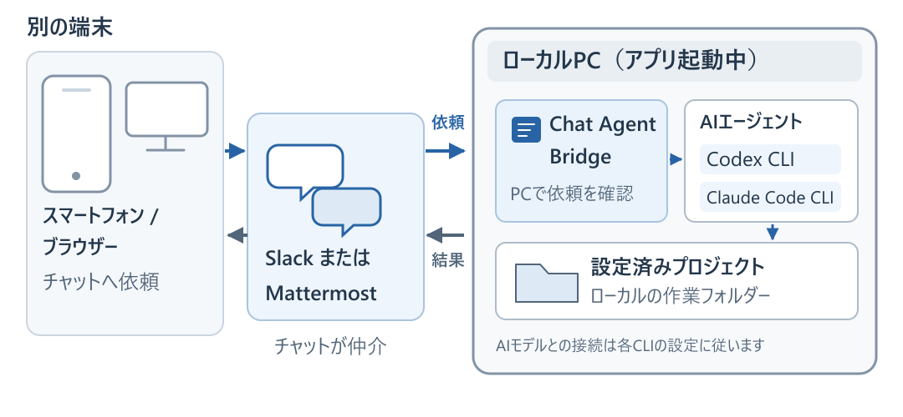
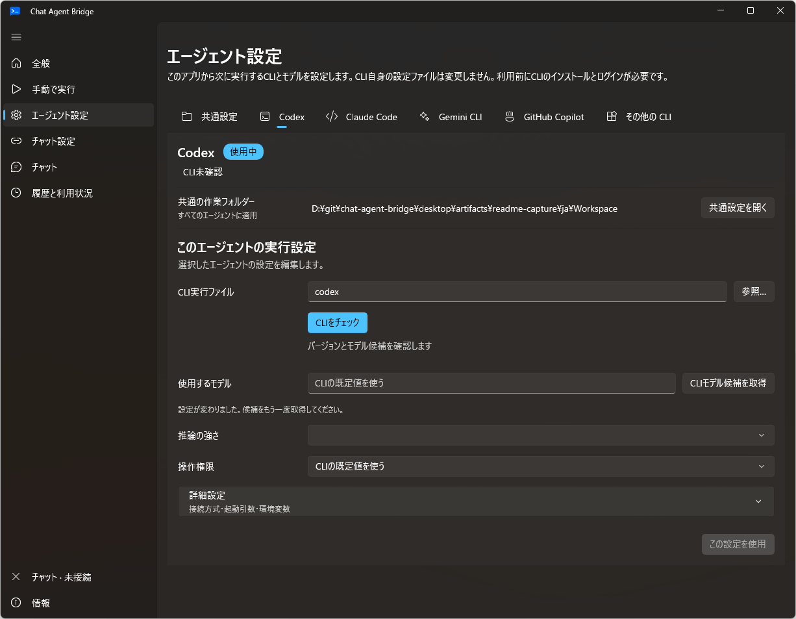
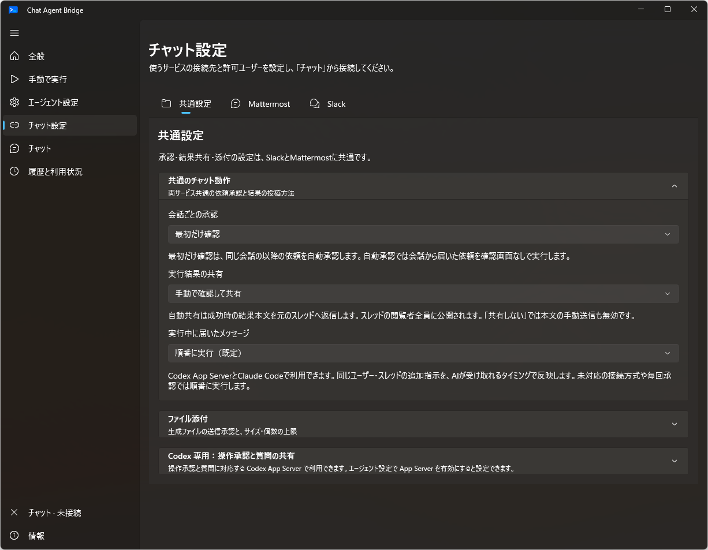
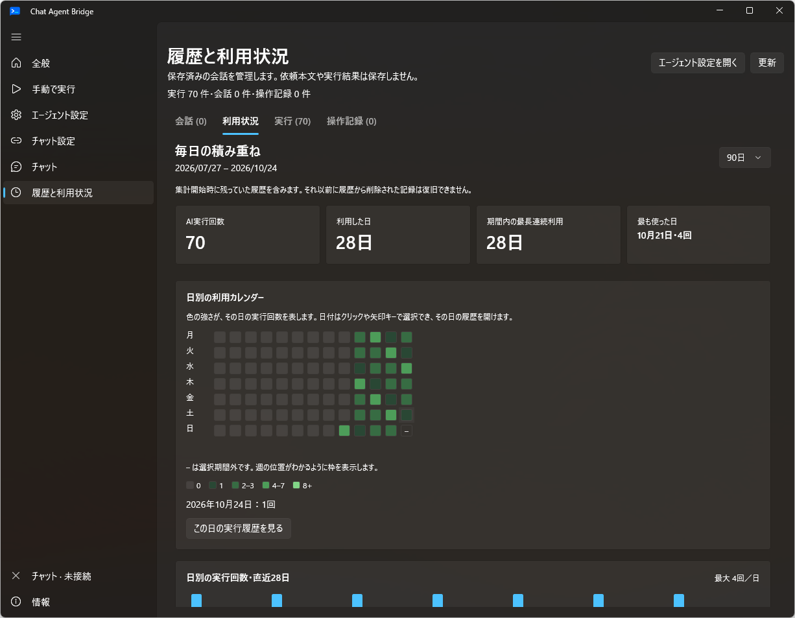
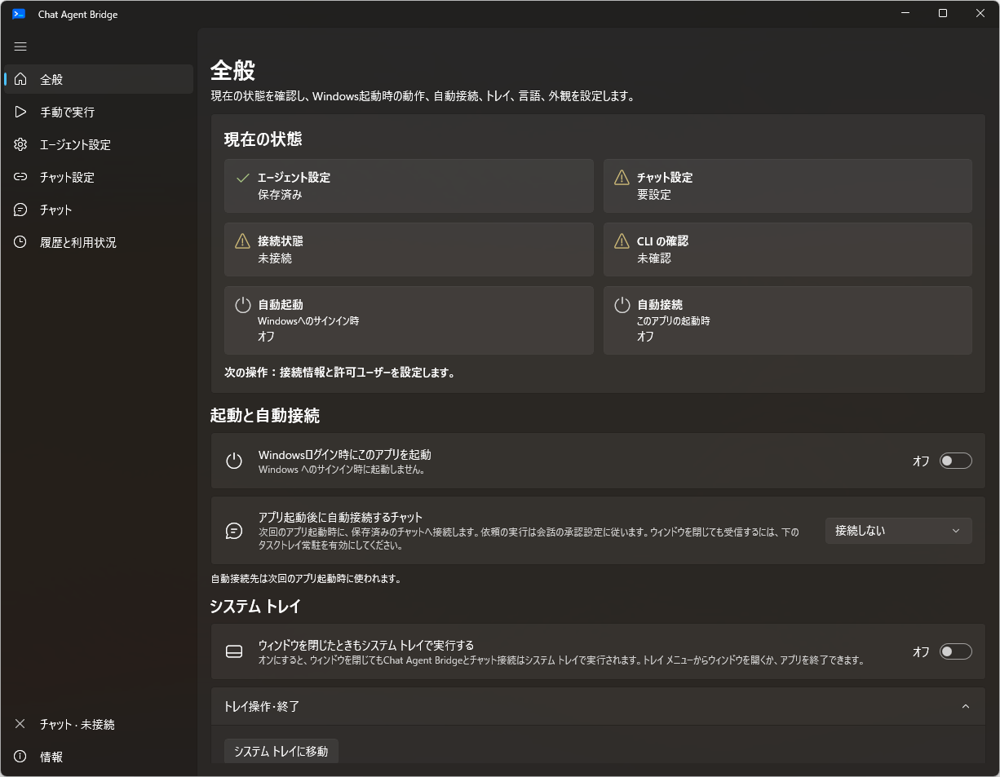

# Chat Agent Bridge

[English](README.md) · **日本語** · [ダウンロード](https://github.com/mmiyaji/chat-agent-bridge/releases)

Chat Agent Bridgeは、SlackやMattermostからWindows PC上のAIエージェントに作業を依頼するアプリです。スマートフォンや別のPCから依頼を送り、同じスレッドで結果を確認したり、追加の指示を送ったりできます。

CodexやClaude Codeのデスクトップアプリを使えない端末からの利用を想定しています。BridgeはWindows PCにインストールしたコマンドライン版のエージェント（CLI）を起動し、指定した作業フォルダーで依頼を実行します。

> AIエージェントの提供元が公式のリモート操作機能を用意している場合は、そちらの利用を推奨します。Chat Agent Bridgeは、利用環境などの制約で公式機能を使えない場合の代替手段として開発しています。

## システム構成と依頼の流れ

アプリの初期設定ガイドと全般画面に掲載している構成図です。図ではCodexとClaude Codeを例にしています。Gemini CLIとGitHub Copilot CLIも同じ構成で利用できます。

1. **別の端末**からSlackまたはMattermostに投稿します。操作する端末にAIエージェントのCLIを入れる必要はありません。
2. **Windows PC上のBridge**が投稿を受け取り、許可ユーザーや会話の承認設定を確認します。承認が必要な依頼は、PCで承認するまで実行を待ちます。
3. **選択したCLI**が、指定された作業フォルダーで依頼を実行します。CLIは自身の設定に従ってAIサービスへ通信し、ファイルの読み書きやコマンド実行を行います。
4. **結果を元のスレッドへ投稿**します。既定ではPCで内容を確認してから送信し、自動返信にも変更できます。同じユーザーがスレッドへ返信すると、対応するCLIでは会話を継続します。

利用中はWindows PCを起動し、Bridgeとチャット接続を維持してください。トレイ常駐中も稼働しますが、PCのスリープ中やサインアウト後は依頼を処理できません。

## 主な機能

| 機能 | 内容 |
| --- | --- |
| チャットからの実行 | Slack・Mattermostからの依頼とスレッド単位の会話継続 |
| エージェント・モデルの変更 | PCとチャットから変更。エージェント変更時に会話の引き継ぎメモを渡すか選択 |
| 進捗確認・中断 | チャットへの進捗投稿、PCでの途中出力の表示、依頼の中断 |
| 追加指示 | 順番待ち、または対応するエージェントの実行中の依頼への追加 |
| アクセス制限 | 許可ユーザー・チャンネル・スレッド・信頼する作業フォルダーの設定 |
| 承認・共有 | 依頼の承認方法、結果の共有方法、添付ファイルの承認と送信上限の設定 |
| 履歴・利用状況 | 会話の管理、実行・操作履歴、利用カレンダー、トークン・キャッシュ・推定コストのグラフ |
| 起動・表示 | 初期設定ウィザード、自動起動・自動接続、トレイ常駐、日本語・英語、ライト・ダーク表示 |

## 導入手順

Windows向けのポータブル版を配布しています。アプリ本体の実行に管理者権限や.NETランタイムの別途導入は不要です。利用するCLIのインストールとログイン、チャット側のBotの準備は別途必要です。

1. [GitHub Releases](https://github.com/mmiyaji/chat-agent-bridge/releases)から、PCに合う**x64 / ARM64**のZIPを取得します。
2. フォルダー全体を書き込み可能な場所へ展開し、`ChatAgentBridge.Desktop.exe`を起動します。
3. 使うCLIをインストールしてCLI自身でログインします。初期設定ガイドでCLIと作業フォルダーを選び、CLIチェックを実行します。
4. **チャット設定**でSlackまたはMattermostの接続情報と許可ユーザーを設定します。Slackでは必要な権限を持つアプリ、MattermostではBotトークンを用意します。
5. **チャット**から接続し、チャット側でBotにメンションして依頼します。Mattermostでは`!cab <依頼内容>`でも開始できます。
6. PCで初回の依頼を承認します。実行後に結果を確認して共有し、続きは同じスレッドへ返信します。

初期値は「会話の最初だけ承認」「結果は手動で共有」「ファイル添付は毎回確認」です。CLIチェックではCLIの種類・バージョンなどを確認します。実行に必要な認証や利用枠は、各CLIで確認してください。

## 対応エージェント

作業フォルダーと信頼範囲は共通設定で、CLIの場所やモデルはエージェント別に設定します。CLI実行ファイルはファイル選択からも指定できます。

| エージェント | 会話の継続 | モデル設定 |
| --- | --- | --- |
| Codex / Claude Code | 対応 | CLIから取得したモデル候補と、対応する推論の強さを選択 |
| Gemini CLI / GitHub Copilot CLI | 対応 | モデル名を入力。推論設定はCLI側で管理 |
| その他のCLI | 毎回独立した実行 | CLIの設定・起動引数で指定 |

会話ごとのエージェント・モデルは、PCの会話詳細またはチャットから変更できます。エージェントを切り替える場合は、アプリで事前に確認・登録したCLIを使い、会話の引き継ぎメモを渡すか選びます。

Codex App ServerとClaude Codeでは、実行中の依頼へ追加指示を送る設定も使えます。同じユーザー・スレッドからの投稿が対象で、それ以外の接続や毎回承認の設定では順番待ちになります。

必要なCLIのバージョンや認証条件は、[CLIごとの対応範囲](desktop/README.ja.md#利用できるcli)を参照してください。Geminiの実サービスでの動作確認は、認証環境による制約で一部未完了です。

エージェント設定の画面

## 承認・アクセス制限・共有

**チャット設定**で、両サービス共通の承認・共有ルールと、サービスごとの接続情報・許可ユーザーを設定します。

- **依頼の承認**は毎回・初回のみ・自動から選べます。これは会話の依頼を開始するための承認です。CLIが個々の操作を行う権限は、別の設定で管理します。
- **アクセス制限**では依頼を受け付けるユーザーや会話を指定します。「信頼する作業フォルダー」には実行を許可するフォルダーを登録します。チャットからのフォルダー変更にも、その範囲の確認とPCでの承認が必要です。
- **結果の共有**は手動・自動・共有しないから選べます。送信した結果は、元のチャットやスレッドを閲覧できる人に公開されます。
- **生成ファイルの添付**は毎回確認が既定です。スレッド初回のみ確認・自動添付・禁止にも変更でき、ファイルごとのサイズ・合計サイズ・個数の上限を設定できます。

## チャットからの操作

依頼の開始後は同じスレッドへ返信します。操作は依頼したユーザーと会話に紐づきます。

| コマンド | 用途 |
| --- | --- |
| `!cab command` | 利用できるコマンド一覧 |
| `!cab status` / `!cab stop` | 自分の依頼の状態確認・中断 |
| `!cab model` | 会話のモデル確認・変更方法 |
| `!cab agent` | 登録済みエージェントと切り替え方法 |
| `!cab folder "C:\Projects\MyApp"` | 作業フォルダーの変更を依頼 |

PCでは実行中の出力を確認して依頼を中断できます。Mattermostでは、Botの進捗投稿にある🛑リアクションを依頼した本人が押すことでも中断できます。中断しても、すでに行われたファイル変更は元に戻りません。

## 履歴と利用状況

保存済みの会話を名前や作業フォルダーで探し、モデルやエージェントを変更できます。実行日時・状態・操作の記録と、このアプリで記録した利用量を確認できます。

利用量は日別・モデル別に表示します。トークン消費量やキャッシュ利用率はCLIが報告した値から集計し、不明な値は「未報告」と表示します。推定コストは公開料金に基づく参考値で、請求額やサブスクリプションの利用枠を示すものではありません。料金表の自動更新と、自動取得した料金より優先する手動設定を使えます。

## 表示・起動・更新

日本語と英語に対応し、Windowsの言語設定が日本語なら日本語、それ以外は英語を使います。アプリから言語を指定することもできます。外観はライト・ダーク・システム設定に合わせる、から選べます。

**全般**でWindowsへのサインイン時の自動起動、アプリ起動時の自動接続、トレイ常駐を設定します。ウィンドウを閉じた際にトレイへ格納するか、完全に終了するかも選べます。

ポータブル版は**情報**から更新を確認・適用できます。設定と履歴はアプリと同じフォルダーの`Data`に保存し、更新後も引き継ぎます。手動で更新する場合は、アプリを終了して`Data`を残してください。別PCへ移す場合は、接続トークンやCLIのログインを再設定します。

画面写真は2026年10月24日のWindows実機上の開発版です。撮影専用の設定とサンプル利用履歴を使い、実際の会話や認証情報は含めていません。日本語版はダーク、英語版はライト表示です。公開版とは画面が異なる場合があります。

## プロジェクトと関連資料

個人の開発作業を想定した非公式の開発プレビューです。OpenAI・Anthropic・Google・GitHub・Slack・Mattermostの公式アプリではありません。利用するチャットサービスとAIサービスの設定・契約も確認してください。

- [利用規約](docs/terms.ja.md) / [プライバシーポリシー](docs/privacy-policy.ja.md)
- [Windowsアプリの詳細ガイド・開発手順](desktop/README.ja.md)
- [ポータブル版の案内](desktop/distribution/README.portable.ja.txt)
- [不具合報告・機能の提案](https://github.com/mmiyaji/chat-agent-bridge/issues)
- [サードパーティーのライセンス](desktop/THIRD-PARTY-NOTICES.txt)（アプリの「情報」からも閲覧可能）

旧TypeScript版の資料は[インストール手順](docs/install.md)・[構成](docs/architecture.md)に残しています。現在のWindowsアプリの導入手順とは異なります。
