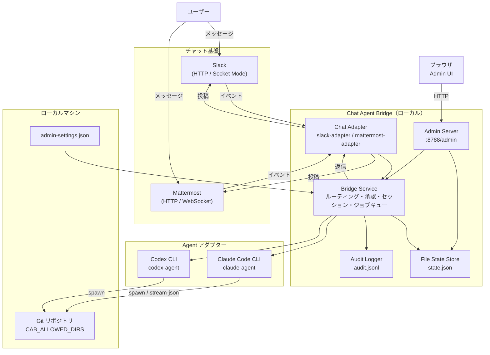

# Chat Agent Bridge

- Languages: [English](README.md) / [日本語](README.ja.md)

Chat Agent Bridge は、チャットスレッドからローカル開発エージェントを継続操作するためのローカル bridge サービスです。ローカル PC 上の repository 状態、未コミット変更、各種ツール状態を保ったまま、同じスレッドから作業を続けられます。

## このプロジェクトの位置づけ

このプロジェクトは、公式プロダクト側でリモートコントロールセッションが十分に提供されるまでの間、個人開発用途を想定して作成している非公式ツールです。

ローカル PC 上で自分自身が使うことを前提にしており、OpenAI、Anthropic、Slack、Mattermost の公式プロダクトではありません。

現在の実装は Windows 前提で、主に PowerShell を使う Windows 環境で開発・検証しています。

## できること

- チャットスレッドをローカル agent session に紐付ける
- 同じマシン上で repo の状態、未コミット変更、ローカルツールの状態を維持する
- Slack と Mattermost の chat adapter を使う
- Codex、Claude Code、experimental な Cursor の agent adapter を使う
- 承認、監査ログ、repo 切り替え、admin 画面を提供する
- Mattermost は `bot` mode と `self` mode の両方をサポートする

## クイックスタート

以下のコマンド例は Windows + PowerShell を前提にしています。

1. 依存関係をインストールします。

```powershell
npm install
npm run check
```

2. 最低限の環境変数を設定します。

```powershell
$env:CAB_ALLOWED_DIRS="C:\Users\mail\Documents\git"
$env:CAB_DEFAULT_WORKDIR="C:\Users\mail\Documents\git\chat-agent-bridge"
```

3. bridge を起動します。

```powershell
npm run dev
```

デモとして、接続済みチャットスレッドから `@Chat Agent Bridge status` を送れます。

または detached service として起動できます。

```powershell
npm run service:start
npm run service:status
```

## デモ

Slack の例:


## よく使う service コマンド

```powershell
npm run service:start
npm run service:status
npm run service:restart
npm run service:restart:build
npm run service:stop
```

## アーキテクチャ



## ドキュメント

- インストールと基本設定: [docs/install.md](docs/install.md)
- Slack 設定: [docs/slack-setup.md](docs/slack-setup.md)
- Mattermost 設定: [docs/mattermost-setup.md](docs/mattermost-setup.md)
- 運用と service 管理: [docs/operations.md](docs/operations.md)
- テストと E2E: [docs/testing.md](docs/testing.md)
- アーキテクチャ: [docs/architecture.md](docs/architecture.md)

## 補足

- bridge はデフォルトで `http://<bridge-host>:8788/admin` に admin server を立てます
- 初期設定は `http://<bridge-host>:8788/admin/onboarding` から進められます
- Codex session はローカルにインストールされた `codex` CLI を使い、既存のローカル login を再利用できます
- bridge は Codex 子プロセスに `CHAT_AGENT_BRIDGE=1` を渡すため、外部 hook 側で重複通知を抑制できます
- Mattermost の `MATTERMOST_ACTOR_MODE=self` は本人トークン運用向けで、self-DM のみを受け付け、その self-DM 内でもメンションが必要です

## 免責事項

- このツールは現状有姿のまま提供され、いかなる保証もありません。
- 作者は、安定性、正確性、安全性、特定用途への適合性を保証しません。
- このツールの利用はすべて自己責任で行ってください。
- このプロジェクトの利用によって発生したデータ消失、repository 破損、アカウント問題、サービス停止、セキュリティ事故、費用発生、その他いかなるトラブルについても、作者は一切責任を負いません。
- この bridge は、実ファイル、repository、接続済みチャット基盤に対してローカル agent を実行できます。利用前に設定内容を十分に確認してください。
- 許可ディレクトリ、token、network access、チャット公開範囲は、必要最小限に制限してください。
- リモート起点でローカル実行を許可する運用上・セキュリティ上のリスクを受け入れられない環境では使用しないでください。
