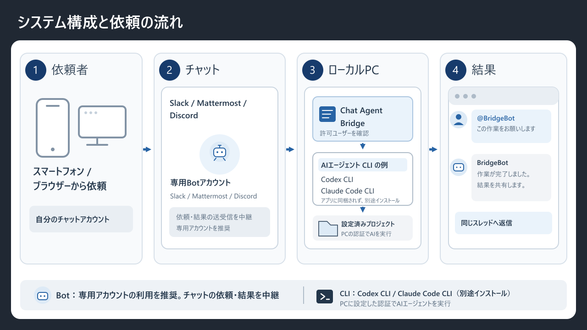
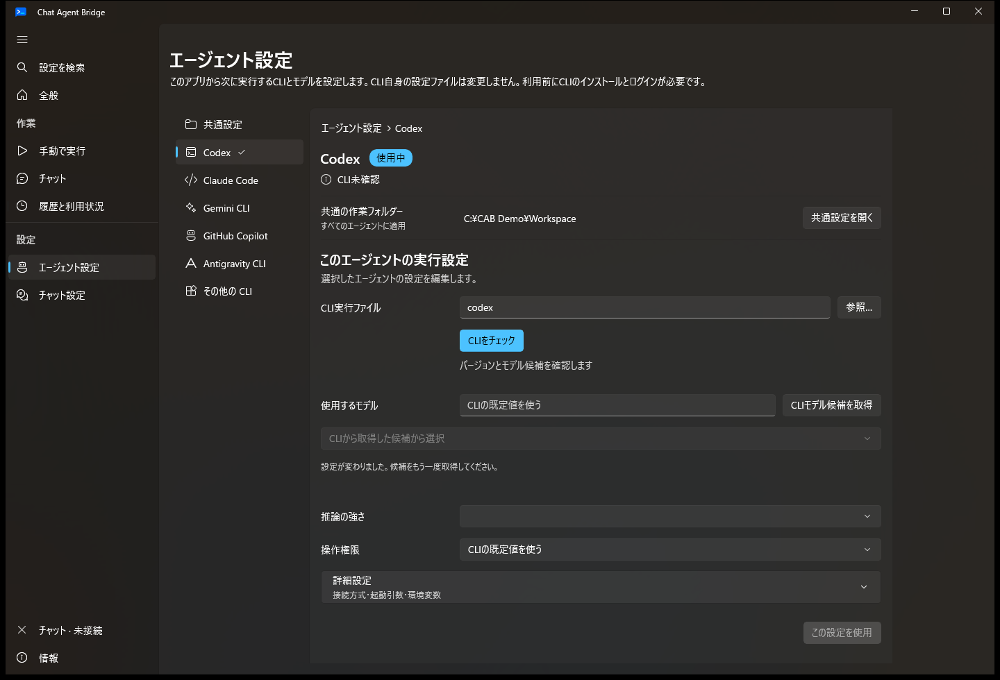
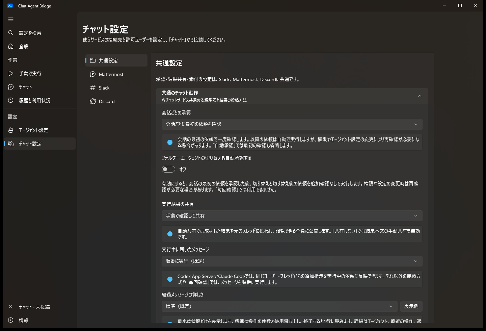
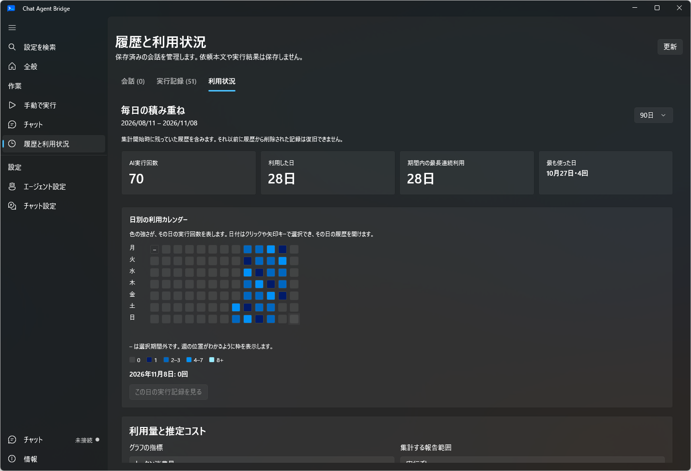
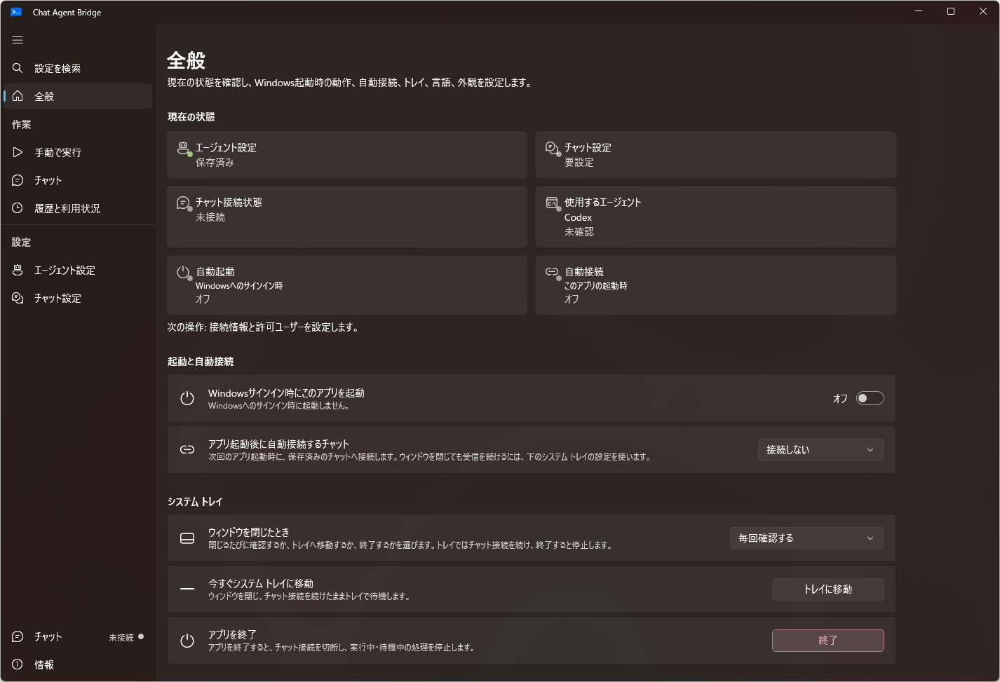

# Chat Agent Bridge

[English](README.md) · **日本語** · [ダウンロード](https://github.com/mmiyaji/chat-agent-bridge/releases)

> **開発プレビュー版です。** 個人の開発作業を想定した非公式アプリで、仕様や画面は予告なく変わる場合があります。OpenAI・Anthropic・Google・GitHub・Slack・Mattermost・Discordの公式アプリではありません。

Chat Agent Bridgeは、Slack・Mattermost・DiscordからWindows PC上のAIエージェントに作業を依頼するアプリです。スマートフォンや別のPCから依頼を送り、同じスレッドで結果を確認したり、追加の指示を送ったりできます。

CodexやClaude Codeのデスクトップアプリを使えない端末からの利用を想定しています。BridgeはWindows PCにインストールしたコマンドライン版のエージェント（CLI）を起動し、指定した作業フォルダーで依頼を実行します。

> AIエージェントの提供元が公式のリモート操作機能を用意している場合は、そちらの利用を推奨します。Chat Agent Bridgeは、利用環境などの制約で公式機能を使えない場合の代替手段として開発しています。

## 安全に使うために

チャットへの投稿をきっかけに、PC上のCLIがファイルの読み書きやコマンド実行を行います。次の点を守って利用してください。

- **許可ユーザーは自分だけにします。** 許可したユーザーは、あなたのPC・CLIの認証・AIサービスの利用枠を使って依頼できます。許可外のユーザーの投稿は無視します。
- **作業フォルダーを限定します。** 「信頼する作業フォルダー」には、AIに触らせてよいフォルダーだけを登録します。ホームフォルダーやドライブ全体は避けてください。
- **自動承認・自動共有は慎重に使います。** 「自動承認」では依頼がPCでの確認なしに実行されます。「自動共有」では結果がスレッドの閲覧者全員に公開されます。初期値は「会話の最初だけ承認」「結果は手動で共有」です。
- **チャンネルやスレッドを絞ります。** 必要に応じて、依頼を受け付けるチャンネル・スレッドを指定します。
- **接続トークンを共有しません。** トークンはWindowsユーザー単位で暗号化して保存しますが、`Data`フォルダーごと他人に渡さないでください。

## システム構成と依頼の流れ

初回ウィザードでは、利用規約・プライバシーポリシーの確認と同意欄を構成図より先に表示します。構成図はクリックで拡大できます。

ウィザードの必須入力は「*」で示します。設定手順をスキップできる場合でも、その手順を設定するには印の付いた項目が必要です。

アプリの初回起動時のウィザードと全般画面に掲載している構成図です。依頼者はスマートフォンやブラウザーから自分のチャットアカウントで専用Botにメンションします。Botには専用アカウントの利用を推奨します。Bridgeは許可ユーザーを確認して、PC上のCLIへ依頼を渡します。Codex CLIとClaude Code CLIは例示で、アプリには同梱されません。利用するCLIは別途インストールと認証が必要です。Muse Code Previewなど、ほかの対応CLIも同じ構成で利用できます。

1. **別の端末**からSlack・Mattermost・Discordに投稿します。操作する端末にAIエージェントのCLIを入れる必要はありません。
2. **Windows PC上のBridge**が投稿を受け取り、許可ユーザーや会話の承認設定を確認します。承認が必要な依頼は、承認するまで実行を待ちます。
3. **選択したCLI**が、指定された作業フォルダーで依頼を実行します。CLIは自身の設定に従ってAIサービスへ通信し、ファイルの読み書きやコマンド実行を行います。
4. **結果を元のスレッドへ投稿**します。既定ではPCで内容を確認してから送信し、自動返信にも変更できます。同じユーザーがスレッドへ返信すると、会話を継続します（[チャットからの操作](#チャットからの操作)を参照）。

## 動作環境

| 項目 | 内容 |
| --- | --- |
| OS | Windows 10（バージョン1809以降）またはWindows 11 |
| CPU | x64 / ARM64（それぞれ専用のZIPを配布） |
| 追加の導入物 | 不要（管理者権限・.NETランタイムの別途導入は不要） |
| CLI | Codex・Claude Code・Gemini CLI・GitHub Copilot CLI・Antigravity CLI・Muse Code Preview、または任意のCLI（各自でインストール・ログイン） |
| チャット | Slack（Socket Mode）・Mattermost（Botトークン）・Discord（Gateway） |
| ネットワーク | PCからチャットサービスへ接続するだけで、外部に公開する受け口（公開URL・ポート開放）は不要 |

## 主な機能

サイドバーにはチャットの接続先と状態を表示します。クリックするとチャット画面が開き、折りたたみ時もサービスのアイコンと状態マークを確認できます。

| 機能 | 内容 |
| --- | --- |
| チャットからの実行 | Slack・Mattermost・Discordからの依頼とスレッド単位の会話継続 |
| エージェント・モデルの変更 | PCとチャットから変更。エージェント変更時に会話の引き継ぎメモを渡すか選択 |
| 進捗確認・中断 | チャットへの進捗投稿、PCでの途中出力の表示、依頼の中断 |
| 追加指示 | 順番待ち、または対応するエージェントの実行中の依頼への追加 |
| アクセス制限 | 許可ユーザー・チャンネル・スレッド・信頼する作業フォルダーの設定 |
| 承認・共有 | 依頼の承認方法、結果の共有方法、添付ファイルの承認と送信上限の設定 |
| チャットからのファイル受信 | 依頼に添付したスクリーンショットやテキスト・ログを、依頼の承認後にローカルのAIへ渡す |
| 履歴・利用状況 | 会話の管理、実行・操作履歴、利用カレンダー、トークン・キャッシュ・推定コストのグラフ |
| 起動・表示 | 初期設定ウィザード、自動起動・自動接続、トレイ常駐、日本語・英語、ライト・ダーク表示 |
| スリープ抑止 | 依頼・手動操作・チャット受信中にWindowsのシステム電源要求を任意で使用。AC電源限定が初期値 |

## ドキュメント

[ドキュメント索引](docs/README.md) — 利用ガイド、開発者向け資料、リリース情報、法的文書、過去の記録。

## 導入手順

Windows向けのポータブル版を配布しています。利用するCLIのインストールとログイン、チャット側のBotの準備は別途必要です。

1. [GitHub Releases](https://github.com/mmiyaji/chat-agent-bridge/releases)から、PCに合う**x64 / ARM64**のZIPを取得します。
2. フォルダー全体を書き込み可能な場所へ展開し、`ChatAgentBridge.Desktop.exe`を起動します。
3. 使うCLIをインストールしてCLI自身でログインします。初期設定ガイドでCLIと作業フォルダーを選び、CLIチェックを実行します。
4. チャットサービス側でBotを用意し、**チャット設定**で接続情報と許可ユーザーを設定します。
   - Slack：[Slackの設定手順](docs/slack-setup.md)（Socket Modeのアプリ・イベント・権限）
   - Mattermost：[Mattermostの設定手順](docs/mattermost-setup.md)（Botトークン・会話のチャンネルID）
   - Discord：[Discordの設定手順](docs/discord-setup.md)（Botトークン・許可サーバーID・Message Content Intent）
5. **チャット**から接続し、チャット側で依頼を投稿します。開始方法はサービスごとに異なります（[チャットからの操作](#チャットからの操作)を参照）。
   接続ボタンは、接続情報と許可ユーザーを保存したサービスだけ有効になります。設定が未完了の場合は、チャット画面の「チャット設定を開く」から設定できます。
6. PCで初回の依頼を承認します。実行後に結果を確認して共有し、続きは同じスレッドへ返信します。

初期値は「会話の最初だけ承認」「結果は手動で共有」「ファイル添付は毎回確認」です。CLIチェックではCLIの種類・バージョンなどを確認します。実行に必要な認証や利用枠は、各CLIで確認してください。

## 対応エージェント

作業フォルダーと信頼範囲は共通設定で、CLIの場所やモデルはエージェント別に設定します。CLI実行ファイルはファイル選択からも指定できます。

| エージェント | 会話の継続 | モデル設定 |
| --- | --- | --- |
| Codex / Claude Code | 対応 | CLIから取得したモデル候補と、対応する推論の強さを選択 |
| Gemini CLI / GitHub Copilot CLI | 対応 | モデル名を入力。推論設定はCLI側で管理 |
| Antigravity CLI（`agy`） | 対応 | `agy models` からモデル候補を取得、またはモデル名を入力。推論設定はCLI側で管理。ヘッドレス実行では、権限モードを「フォルダー内の編集を自動許可」「フルアクセス」にするか、`settings.json` に許可ルールを追加しない限り、編集とコマンドは自動的に拒否されます |
| Kiro CLI（`kiro-cli`、Windows 11） | 実装済み・実サービス未検証 | CLIからモデル候補を取得、またはモデルIDを指定。`KIRO_API_KEY` が必要。権限・推論設定はCLI側で管理し、クレジットはトークン料金に換算しません |
| Qwen Code（`qwen`） | Preview・実サービス未検証 | モデルIDを直接入力。認証・推論・操作権限はCLI側の設定。YOLOフラグを自動付与しません |
| Kimi Code CLI（`kimi`） | Preview・実サービス未検証 | モデル名または設定済み別名を直接入力。「継承」ではツール操作の承認を求めます。「フルアクセス」はKimiがそのモードを受け付けた場合のみ使います。OSレベルのサンドボックスは提供しません |
| Muse Code（`muse`） | Preview・実サービス未検証 | モデル名を直接入力。権限はMuse Code側で管理し、推論設定とモデル一覧取得には未対応 |
| その他のCLI | 毎回独立した実行 | CLIの設定・起動引数で指定 |

Museの依頼文は専用の一時ファイルで渡し、実行後に削除します。異常終了で残ったファイルもアプリ起動時に確認します。Kimiの操作承認では、取得できたコマンドの危険度を表示し、判定できない操作は注意を表示します。承認待ちはKimiの実行時間制限に含みません。Museが会話の作成を確認した後に依頼が失敗した場合は、会話IDを保持して次の依頼で引き継ぎます。失敗した依頼を初回承認済みとしては扱いません。

会話ごとのエージェント・モデルは、PCの会話詳細またはチャットから変更できます。エージェントを切り替える場合は、アプリで事前に確認・登録したCLIを使い、会話の引き継ぎメモを渡すか選びます。

Codex App ServerとClaude Codeでは、実行中の依頼へ追加指示を送る設定も使えます。同じユーザー・スレッドからの投稿が対象で、それ以外の接続や毎回承認の設定では順番待ちになります。MuseとKimiも実行を中断できますが、実行中への追加指示は直接反映せず順番待ちになります。

必要なCLIのバージョンや認証条件は、[CLIごとの対応範囲](desktop/README.ja.md#利用できるcli)を参照してください。

エージェント設定の画面

## 承認・アクセス制限・共有

手動実行はCABの展開先ではなく、エージェント設定の作業フォルダーで行います。PCで指定・保存した作業フォルダーは既定で信頼されます。別の親フォルダーも登録すると、その配下へ会話の作業先を切り替えられます。チャットから指定された範囲外の場所は自動登録されず、切り替えは承認設定に従います。Git管理は必須ではなく、フォルダーを信頼してもフルアクセスにはなりません。

**チャット設定**で、各サービス共通の承認・共有ルールと、サービスごとの接続情報・許可ユーザーを設定します。

- **依頼の承認**は毎回・初回のみ・自動から選べます。これは会話の依頼を開始するための承認です。CLIが個々の操作を行う権限は、別の設定で管理します。
- Codex App Serverの操作承認では、明確に破壊的な一部のコマンドに注意を表示します。注意表示は承認方法を変えず、CLI側の権限設定に代わるものでもありません。
- **アクセス制限**では依頼を受け付けるユーザーや会話を指定します。「信頼する作業フォルダー」には実行を許可するフォルダーを登録します。チャットからのフォルダー変更にも、その範囲の確認とPCでの承認が必要です。
- **結果の共有**は手動・自動・共有しないから選べます。送信した結果は、元のチャットやスレッドを閲覧できる人に公開されます。
- **生成ファイルの添付**は毎回確認が既定です。スレッド初回のみ確認・自動添付・禁止にも変更でき、ファイルごとのサイズ・合計サイズ・個数の上限を設定できます。
- **承認のチャット共有**は、Codex App Serverを使う場合だけ有効にできます。有効にすると、依頼した本人がチャットから承認できます（下表）。初期値は無効で、PCで承認します。

| サービス | 依頼の開始の承認 | CLIの操作（コマンド実行・ファイル変更）の承認 |
| --- | --- | --- |
| Slack / Mattermost | PCで承認 | `!cab approve <コード>` / `!cab reject <コード>` |
| Discord | 承認・拒否ボタン | 承認・拒否ボタン |

### 依頼に付けたファイルの受信

依頼に添付したファイルは、依頼の承認後に受け取ってAIへ渡します。受信の上限は、生成ファイルの送信設定とは別です。

| 項目 | 内容 |
| --- | --- |
| 対応形式 | PNG / JPEG / WebP画像、UTF-8のTXT / LOG / MD / CSV / JSON |
| 上限 | 最大5個、1個10MB、合計20MB |
| 保存先 | 信頼する作業フォルダー内に一時保存し、そのパスをAIへ渡す |
| 保存期間 | 実行後に削除。後の依頼でも必要な場合は再添付 |
| 追加指示 | 添付付きの追加指示は、別の実行として順番に処理 |
| 画像 | 内容の確認にはCLI側の画像読み取りツールが必要 |
| Slackの権限 | Botの `files:read` 権限が必要。権限を追加した後はアプリを再認可 |

## チャットからの操作

操作は依頼したユーザーと会話（チャンネル・スレッド・ユーザー）に紐づきます。他のユーザーが同じスレッドに投稿しても、あなたの会話としては扱いません。

| 操作 | Slack | Mattermost | Discord |
| --- | --- | --- | --- |
| 依頼の開始 | Botへのメンション | Botへのメンション、または `!cab <依頼内容>` | Botへのメンション、または `!cab <依頼内容>` |
| 会話の続き | 同じスレッドへ返信 | 同じスレッドへ返信 | 同じスレッドへ返信 |
| 状態の確認 | `!cab status` | `!cab status` | `!cab status` |
| 中断 | `!cab stop` | `!cab stop`、または進捗投稿の🛑リアクション | `!cab stop`、または進捗投稿の中断ボタン |

- **会話の続き**：最初の依頼の後は、同じスレッドへの返信がそのまま続きの依頼になります。メンションや `!cab` は不要です。
- **アプリ再起動後**：「チャット」の会話一覧は再起動後も復元されますが、承認待ち・実行中だった依頼は自動再開せず「中断」と表示します。続ける場合は、同じスレッドで依頼を新しく開始してください（Slackはメンション、MattermostとDiscordはメンションか `!cab`）。
- **中断**：リアクションやボタンは依頼した本人だけが操作できます。中断しても、すでに行われたファイル変更は元に戻りません。
- **リアクションで承認（Mattermost）**：「承認をチャットで共有」がオンのとき、Botは承認依頼の投稿に✅と❌を付けます。押せるのは依頼した本人だけで、決定後は投稿に `→ ✅` か `→ ❌` が追記されます。オフの場合はPCで承認します。
- **経過メッセージの詳しさ**：チャット設定の「経過メッセージの詳しさ」で、最小（状態のみ）、標準（既定。1行で表示し、終了すると操作件数と使用量の1行に畳む）、詳細（エージェント・モデル・権限・直近の操作・返信のヒント）を選べます。標準では、確認なしで実行される権限のときだけ権限を表示し、返信と中断のヒントは依頼者ごとにアプリ起動後の初回だけ表示します。

| コマンド | 用途 |
| --- | --- |
| `!cab command` | 利用できるコマンド一覧 |
| `!cab status` / `!cab stop` | 自分の依頼の状態確認・中断 |
| `!cab model` | 会話のモデル確認・変更方法 |
| `!cab agent` | 登録済みエージェントと切り替え方法 |
| `!cab folder "C:\Projects\MyApp"` | 作業フォルダーの変更を依頼 |
| `!cab worktree 名前` | この会話用のgit worktree（`.cab/worktrees/名前`、ブランチ `cab/名前`）を依頼。PCで承認 |
| `!cab remember 内容` / `!cab memory` / `!cab forget 番号\|all` | チャンネルのメモを保存・一覧・削除（最大20件、各500文字）。メモはそのチャンネルのすべての依頼に付き、利用を許可された全員に効きます |
| `!cab usage` | このスレッドと自分の今日のトークン使用量・推定コスト |

`!cab status` は、そのスレッドで自分が依頼した実行中・承認待ち・順番待ちの処理を、エージェント・モデル・権限・作業フォルダー付きで表示します。権限が「継承」のときは、CLI側の設定で実際に何になるかを表示し、確認なしで実行されるモードには⚠を付けます。他のユーザーやスレッドの依頼は表示しません。返信はそのスレッドを閲覧できる人に公開されます。

PCでも実行中の出力を確認し、依頼を中断できます。

## 履歴と利用状況

保存済みの会話を名前や作業フォルダーで探し、モデルやエージェントを変更できます。実行日時・状態・操作の記録と、このアプリで記録した利用量を確認できます。

利用量は日別・モデル別に表示します。トークン消費量やキャッシュ利用率はCLIが報告した値から集計し、不明な値は「未報告」と表示します。推定コストは公開料金に基づく参考値で、請求額やサブスクリプションの利用枠を示すものではありません。料金表の自動更新と、自動取得した料金より優先する手動設定を使えます。

## 保存するデータ

設定と履歴は、アプリと同じフォルダーの`Data`に保存します。

| 保存するもの | 保存しないもの |
| --- | --- |
| 接続設定（トークンはWindowsユーザー単位のDPAPIで暗号化） | 依頼の本文 |
| 会話一覧の表示情報（表示名・送信元・作業フォルダー・最終利用日時・状態） | 実行結果の本文 |
| 実行・操作の履歴（日時・状態・会話の識別子など。最大500件） | CLIの認証情報（各CLIが自身で管理） |
| 日別・モデル別の利用量の集計 | |

保存したデータは、**全般**のデータ管理から種類を選んで削除できます。暗号化したトークンは同じWindowsユーザーでしか復号できないため、別PCへ移す場合は接続トークンとCLIのログインを再設定します。詳細は[プライバシーポリシー](docs/privacy-policy.ja.md)を参照してください。

## 表示・起動・更新

日本語と英語に対応し、Windowsの言語設定が日本語なら日本語、それ以外は英語を使います。アプリから言語を指定することもできます。外観はライト・ダーク・システム設定に合わせる、から選べます。

**全般**でWindowsへのサインイン時の自動起動、アプリ起動時の自動接続、トレイ常駐を設定します。ウィンドウを閉じた際にトレイへ格納するか、完全に終了するかも選べます。実行中・待機中の依頼がある場合、終了確認に合計件数と展開可能な状態別件数を表示します（確認画面を開いた時点の集計です）。終了処理中は「終了しています…」を表示し、切断と保存の完了を待ちます。

ポータブル版は**情報**から更新を確認・適用できます。ダウンロード中と一時停止中は受信済み容量と総容量を表示します。転送速度・推定残り時間、通信待ちの経過秒数、再試行の回数、検証・更新準備の処理段階を確認でき、キャンセルも可能です。データを5分間受信できない場合は再試行します。一時停止・再開と、アプリ再起動後の続きからの取得に対応します。通信エラーは最大3回自動再試行し、完了時に全体のSHA-256を検証します。`Data`は更新後も引き継ぎます。完了した更新のダウンロードや一時的なバイナリは自動で整理し、ログや更新記録は保持します。情報の「更新の設定」で使用容量を確認できます。手動の整理は「情報 → 詳細設定 → 保守」から行えます。手動で更新する場合は、アプリを終了してから`Data`を残して入れ替えてください。

画面写真は2026年11月2日に開発版から撮影しました。撮影専用の設定と
サンプル利用履歴を使い、実際の会話や認証情報は含めていません。利用統計には
過去28稼働日のサンプル70件が集計されています。詳細履歴には既定の30日保持
期間内にある52件が表示され、期間を過ぎた明細の集計値は統計に残ります。
いずれも動作例で、性能の実測値ではありません。公開版とは画面が異なる場合があります。

## アンインストール

1. **全般**で「Windowsログイン時にこのアプリを起動」をオフにします（自動起動はWindowsのユーザー設定に登録しているため、フォルダーを削除する前に解除します）。
2. アプリをトレイからも終了します。
3. 展開したフォルダーを削除します。`Data`には暗号化した接続トークンと履歴が含まれるため、残す必要がなければ一緒に削除してください。
4. 必要に応じて、Slack・Mattermost・DiscordのBotトークンを各サービスで無効化します。

## 既知の制限

- Windows専用です。macOS・Linuxには対応していません。
- PCのスリープ中、サインアウト後、アプリの終了後は依頼を処理できません。利用中はPCを起動し、Bridgeとチャット接続を維持してください（トレイ常駐中も稼働します）。
- アプリの再起動で中断した依頼は自動再開しません。
- その他のCLIは会話を継続せず、毎回独立して実行します。
- Gemini CLIの実サービスでの動作確認は、認証環境による制約で一部未完了です。
- 推定コストは参考値で、実際の請求額とは一致しない場合があります。

## トラブルシューティング

| 症状 | 確認すること |
| --- | --- |
| Botが反応しない | **チャット**で接続中か。投稿者が許可ユーザーか。チャンネル・スレッドが許可範囲内か。開始方法が正しいか（[チャットからの操作](#チャットからの操作)） |
| Discordで反応しない | Developer Portalで**Message Content Intent**が有効か。許可サーバーIDが正しいか。Botにチャンネルの閲覧・送信権限があるか |
| Slackで添付ファイルを受け取れない | Botに `files:read` 権限があるか。権限を追加した後にアプリを再認可したか |
| CLIが見つからない | 初期設定ガイドまたはエージェント設定で**CLIチェック**を実行。CLIを導入・更新した直後は「環境変数を再読み込み」を実行 |
| Claude Codeで「Not logged in」 | このWindowsユーザーのターミナルでClaude Codeを起動し、`/login` を完了してから依頼を再投稿 |
| 承認待ちのまま進まない | 依頼の開始にはPCでの承認が必要です（初期値）。PCの**チャット**またはWindows通知から承認 |
| 結果がスレッドに届かない | 初期値では結果は手動共有です。PCで内容を確認して「結果をスレッドに送信」 |

## ライセンス

[MIT License](LICENSE) で公開しています。利用するチャットサービスとAIサービスの規約・契約は、別途確認してください。

## プロジェクトと関連資料

- [利用規約](docs/terms.ja.md) / [プライバシーポリシー](docs/privacy-policy.ja.md)
- [Windowsアプリの詳細ガイド・開発手順](desktop/README.ja.md)
- [ポータブル版のリリース手順](RELEASE.md)
- [ポータブル版の案内](desktop/distribution/README.portable.ja.txt)
- [不具合報告・機能の提案](https://github.com/mmiyaji/chat-agent-bridge/issues)
- [サードパーティーのライセンス](desktop/THIRD-PARTY-NOTICES.txt)（アプリの「情報」からも閲覧可能）

Kiro CLIは `chat --v2 --no-interactive --output-format stream-json` に標準入力で依頼を渡します。Windows 11用のネイティブCLIを導入し、PC側で `KIRO_API_KEY` を設定してください。`--trust-all-tools` は自動付与しません。CLI側の確認が必要な操作は拒否される場合があります。実行中の追記は順番に処理します。実際の認証・出力形式との互換性・チャット実行は、Kiro導入環境での追加確認が必要です。[Kiro公式仕様](https://kiro.dev/docs/cli/headless/)

Qwen CodeはWindowsの公式スタンドアロン版とnpm版に対応します。KimiはAgent Client Protocol（ACP）モードを使い、「継承」ではツール操作の承認を求めます。「フルアクセス」はKimiが明示的なモードを提示した場合のみ選択できます。権限はKimiが適用し、OSレベルのサンドボックスは提供しません。モデルは直接入力で指定します。実サービスでの検証は保留中です。[Qwenの導入方法](https://github.com/QwenLM/qwen-code/blob/main/scripts/installation/INSTALLATION_GUIDE.md)、[Kimi ACPドキュメント](https://moonshotai.github.io/kimi-code/en/reference/kimi-acp.html)。

設定画面ではエージェント・チャットサービスごとに異なるアウトラインアイコンを表示します。Gemini CLIには「移行推奨」を表示し、新規設定にはAntigravity CLIを推奨します。Gemini CLIの企業契約・APIキー利用は継続対象です。[Googleの移行案内](https://developers.googleblog.com/an-important-update-transitioning-gemini-cli-to-antigravity-cli/)。

WindowsのQwen公式スタンドアロン版は、`qwen`、公式の`qwen.cmd`、または同梱の`node.exe`を指定できます。CABが配置を検証し、Qwen本体のJavaScriptファイルを自動で解決します。

エージェント設定の「自動検出」で選択中のCLIをPATHから探し、「CLIをチェック」で起動を確認できます。Qwenの登録時は、内部のNode.jsパスではなく入力した`qwen`を保存します。
