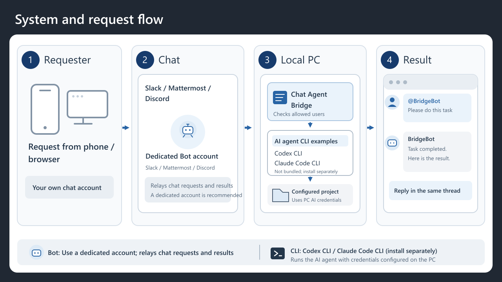
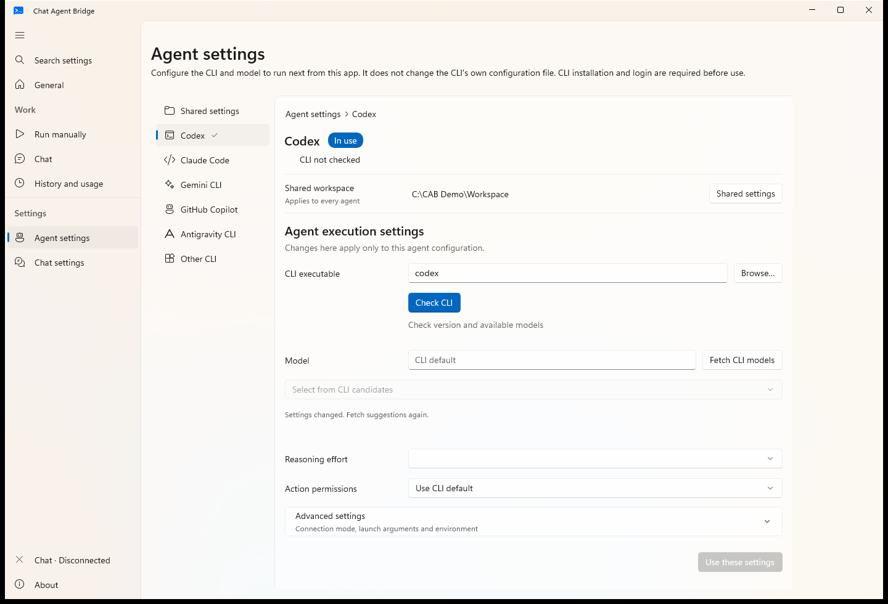
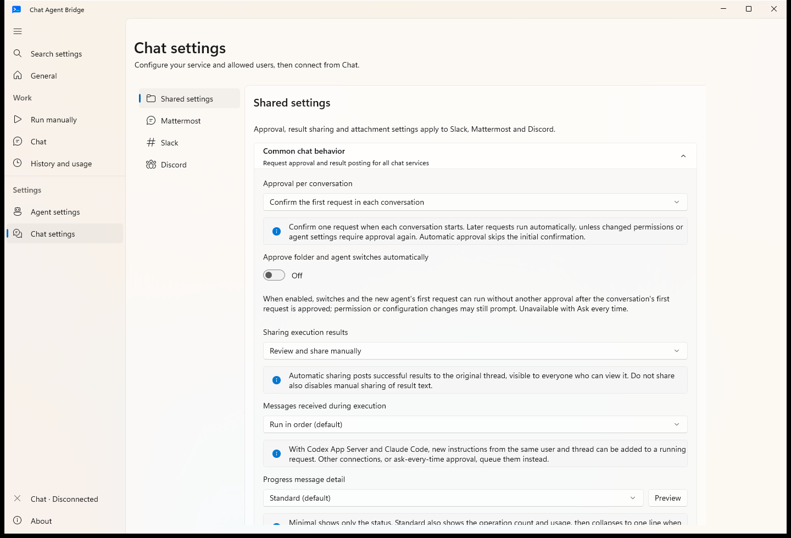
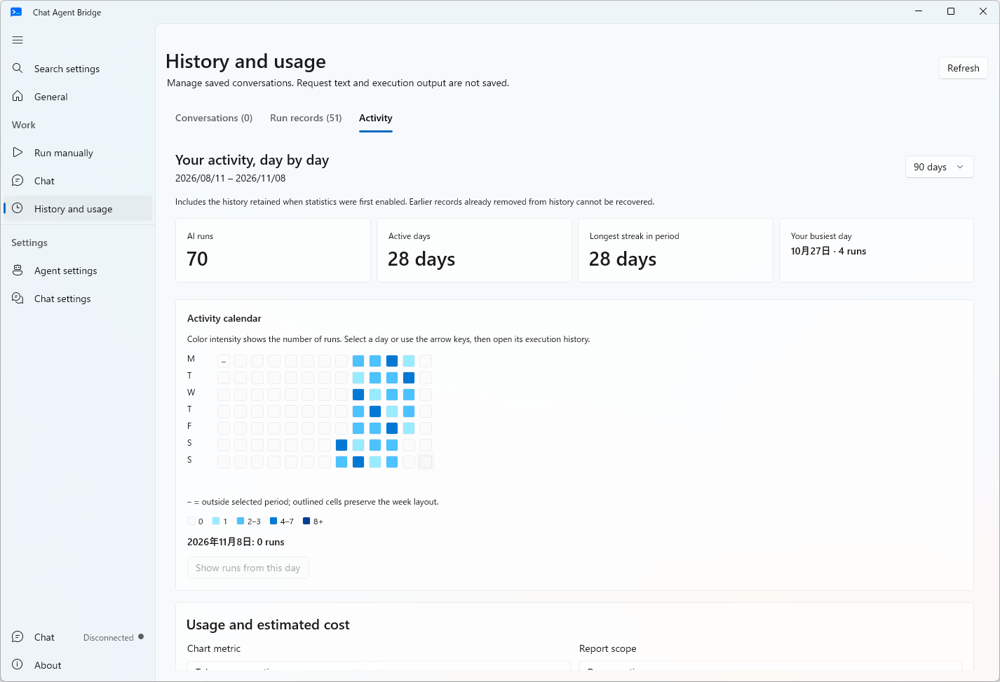
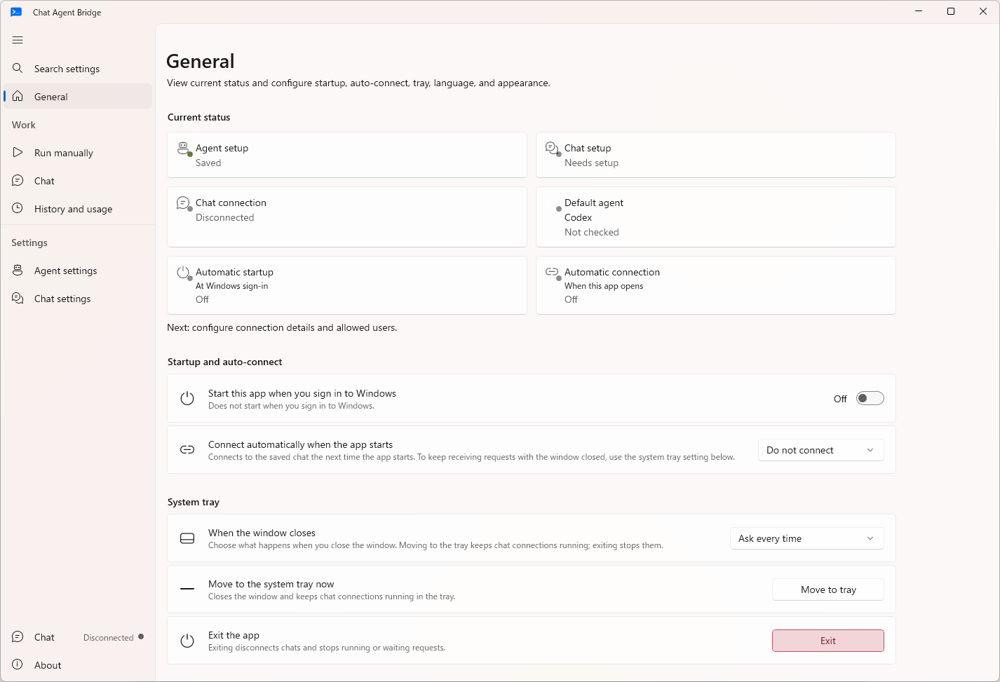
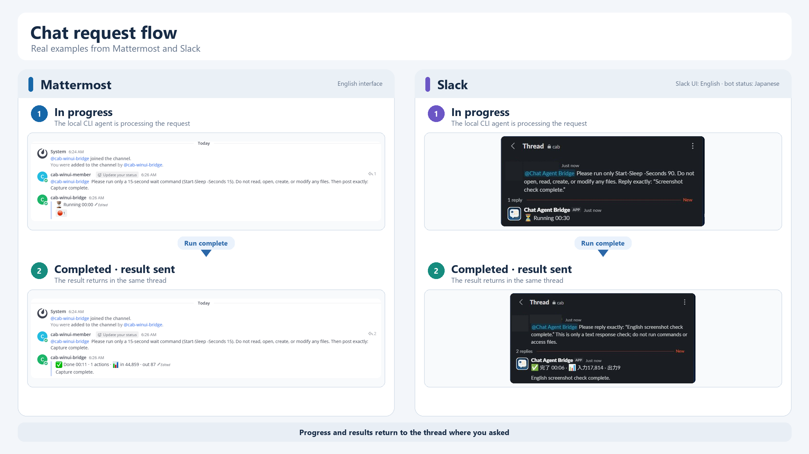

# Chat Agent Bridge

**English** · [日本語](README.ja.md) · [Download](https://github.com/mmiyaji/chat-agent-bridge/releases)

> **Development preview.** This is an unofficial app for personal workflows, and its behavior and screens may change without notice. It is not an official OpenAI, Anthropic, Google, GitHub, Slack, Mattermost or Discord app.

Chat Agent Bridge is a Windows app that accepts requests from Slack, Mattermost or Discord and runs AI agents on your PC. You can send requests from a phone or another computer, review results and add instructions in the same thread.

It is intended for devices where you cannot use the Codex or Claude Code desktop app. Bridge starts a command-line agent (CLI) installed on your Windows PC and runs the request in the working folder you selected.

> **Prefer remote-control features offered through the AI agent provider's official desktop app or another official client when available.** Chat Agent Bridge is an alternative for environments where those features are unavailable.

## Using it safely

A chat post causes the CLI on your PC to read and write files and run commands. Follow these guidelines:

- **Allow only yourself.** An allowed user can send requests that use your PC, your CLI sign-in and your AI service quota. An explicit request from another user can be shown for PC approval when it is in an allowed conversation. **Allow and run** adds them to the allowed users; **Run once** and **Deny** are also available. Each decision is recorded in the activity history.
- **Limit automatic execution to allowed users.** With the default, “No approval for allowed users,” requests from allowed users run without confirmation on the PC. Unlisted users cannot run work without a PC decision. “Confirm the first request in each conversation” and “Ask every time” add approvals on the PC, which makes remote use harder. Keep the allowed-user list restricted to yourself.
- **Limit the working folders.** Register only folders the agent may touch as trusted working folders. Avoid your home folder or an entire drive.
- **Use automatic sharing with care.** Automatic sharing makes results visible to everyone who can read the thread. The defaults are “No approval for allowed users” and automatic result sharing.
- **Narrow the channels and threads.** If needed, restrict which channels and threads can send requests.
- **Do not share your connection tokens.** Tokens are encrypted per Windows user, but do not hand the `Data` folder to anyone else.

## System overview and request flow

The first-run wizard shows the terms and privacy policy links and consent checkboxes before the diagram. Click the diagram to enlarge it.

Required wizard fields are marked with an asterisk (*). These fields are required when configuring that step, even if the step can be skipped.

The requester uses their regular chat account. The Bot is a separate service account that Bridge uses to connect to chat and post replies. The AI agent CLI is installed and signed in separately on the PC; its AI-service credentials are also separate from the chat Bot credentials. Codex CLI and Claude Code CLI are examples; they are not bundled. Other supported CLIs, including Muse Code Preview, use the same arrangement.

1. **Post from another device** in Slack, Mattermost or Discord. That device does not need an agent CLI installed.
2. **Bridge on the Windows PC** receives posts while the app is running and connected. An allowed conversation is a configured DM or channel, optionally limited to selected threads. Requests from allowed users follow the configured approval mode. An explicit request from another user in that scope can be shown for PC approval; choose **Run once**, **Allow and run**, or **Deny**.
3. **The selected CLI** runs the request in the configured working folder. It connects to AI services according to its own settings and performs file operations or commands.
4. **Return the result to the original conversation.** Request results can be shared automatically, manually or not at all. Generated-file attachments require PC approval each time by default. Anything sent is visible to people who can access that conversation. The same user can reply in the same thread to continue (see [Chat operations](#chat-operations)).

Closing the app stops receiving and running requests. CAB attempts to reconnect after transient connection failures, but a post sent while disconnected is not guaranteed to be delivered later. Check the connection status and repost any request that did not arrive. Request approval, the CLI's permission to perform individual operations, result sharing and file-attachment approval are separate controls (see [Approvals, access and sharing](#approvals-access-and-sharing)).

If Chat Agent Bridge itself hits an unexpected error while handling a request, the inbox ends the running state and puts a safe diagnostic before the bounded CLI output. A normal failure reported by the CLI remains a CLI failure. The diagnostic omits exception messages, paths, command arguments and request content. Its allowlisted cause, exception type and HRESULT are also saved in the local audit log (`audit-segment-*.jsonl`) for later troubleshooting and follow the app's audit log retention settings.

If the CLI finishes but saving its final history status fails, the app keeps the known CLI result separate from the save error. It first writes only safe terminal metadata to a local recovery file, then repairs history when storage is available, including after a restart. If neither copy can be saved, the unresolved history entry is shown as interrupted. The CLI is never rerun automatically. No prompt, output or exception message is written to the recovery file.

## Requirements

| Item | Details |
| --- | --- |
| OS | Windows 10 (version 1809 or later) or Windows 11 |
| CPU | x64 / ARM64 (a separate ZIP for each) |
| Additional installs | None (no administrator rights or separate .NET runtime required) |
| CLI | Codex, Claude Code, Gemini CLI, GitHub Copilot CLI, Antigravity CLI, Muse Code Preview or another CLI (install and sign in yourself) |
| Chat | Slack (Socket Mode), Mattermost (bot token over REST API and WebSocket), Discord (Gateway) |
| Network | The PC connects out to the chat service; no public URL or open port is needed |

These are app-to-service connections maintained from the PC. Request start rules and channel or thread behavior differ by provider; see each service's setup guide.

## Main features

The sidebar shows the connected chat service and its status. Select it to open Chat; when the sidebar is collapsed, the service icon and status marker remain visible.

| Feature | Description |
| --- | --- |
| Chat requests | Slack, Mattermost and Discord requests with thread-based conversation continuation |
| Agent and model changes | Change them from the PC or chat; choose whether to pass conversation notes when switching agents |
| Progress and cancellation | Chat progress posts, live output on the PC and request cancellation |
| Additional instructions | Queue messages or add them to a running request on supported agents |
| Access restrictions | Allowed users, channels, threads and trusted working folders |
| Approval and sharing | Request approvals, result sharing, attachment approvals and upload limits |
| Files sent from chat | Pass screenshots and text/log files attached to a request to the local agent after request approval |
| History and usage | Conversation management, execution and operation history, an activity calendar, and token, cache and estimated-cost charts |
| Startup and appearance | Setup wizard, startup and auto-connect, system tray mode, English/Japanese and light/dark appearance |
| Keep awake | Windows system power request during chat requests or manual work by default; enabled only on AC power |

## Documentation

[Documentation index](docs/README.md) — user guides, developer references, release notes, legal notices and archived records.

## Installation and setup

Install from the [Microsoft Store](https://apps.microsoft.com/detail/9n1lzk25fsgr) or use a portable build from GitHub Releases. Set up your CLI and chat bot separately.

1. For a portable installation, download the **x64 / ARM64** ZIP for your PC from [GitHub Releases](https://github.com/mmiyaji/chat-agent-bridge/releases).
2. Extract the ZIP to a writable folder and run `ChatAgentBridge.Desktop.exe`. Launch the Store edition from the Start menu.
3. Install the CLI and sign in through it. Select the CLI and working folder in the setup guide, then run the CLI check.
4. Configure the chat service and bot connection in the first-run wizard. Direct messages are enabled by default, so you can start with a dedicated DM with the bot. Add shared channels or channel restrictions later in **Chat settings** if needed. Under **Common settings → Allowed users**, add your own account (at least one user is required to connect). Requests from other users in an allowed conversation can wait for a decision on the PC.
   - Slack: [Slack setup guide](docs/slack-setup.md) (Socket Mode app, events and scopes)
   - Mattermost: [Mattermost setup guide](docs/mattermost-setup.md) (current screenshots show the card layout, individual DMs and shared-channel search)
   - Discord: [Discord setup guide](docs/discord-setup.md) (bot token, allowed server IDs and Message Content Intent)
5. Connect from **Chat** and post a request. How to start depends on the service (see [Chat operations](#chat-operations)).
   Connect buttons are enabled only for services with saved connection details. If none are ready, use **Open chat settings** in Chat to finish setup.
6. By default, requests from allowed users run without approval on the PC, and the result is posted automatically in the same thread. Reply there to continue.

By default, requests from allowed users run without approval, results are shared automatically and every attachment requires approval. The CLI check identifies the CLI and version. Check authentication and available quota through the CLI itself.

## Supported agents

The working folder and trusted locations are shared settings. Configure the executable and model separately for each agent. You can also select the CLI executable with a file picker.

| Agent | Conversation continuation | Model settings |
| --- | --- | --- |
| Codex / Claude Code | Supported | Select CLI-provided model and supported reasoning-effort candidates |
| Gemini CLI / GitHub Copilot CLI | Supported | Enter a model name; reasoning settings remain CLI-managed |
| Antigravity CLI (`agy`) | Supported | Fetch the model list from `agy models` or enter a model name; reasoning stays CLI-managed. Headless mode auto-denies edits and commands unless the permission mode is workspace write or full access, or `settings.json` has allow rules |
| Kiro CLI (`kiro-cli`, Windows 11) | Implemented; live-service verification pending | Fetch models from the CLI or enter a model ID. Headless runs require `KIRO_API_KEY`; permissions and reasoning remain CLI-managed. Credits are not shown as token costs |
| Qwen Code (`qwen`) | Preview; live-service verification pending | Enter a model ID. CLI-managed authentication, reasoning and tool permissions; no automatic YOLO flag |
| Kimi Code CLI (`kimi`) | Preview; live-service verification pending | Enter a model name or configured alias. Inherit mode requests approval for tool calls; Full access is used only when Kimi accepts that mode. Kimi enforces its permissions; no OS sandbox is provided |
| Muse Code (`muse`) | Preview; live-service verification pending | Enter a model name manually. Muse Code manages permissions; reasoning selection and model discovery are not available |
| Other CLI | Independent execution for each request | Configure the CLI or its launch arguments |

Muse passes requests through private temporary files, which are removed after execution; abandoned files are checked at app startup. Kimi approval dialogs show command risk when the command is available and warn when the operation cannot be classified. Waiting for approval does not consume Kimi’s execution timeout. If Muse confirms that a session was created before a request fails, CAB keeps its ID so the next request can continue it. The failed request does not count as a successful first approval.

Change a conversation's agent or model from its details on the PC or from chat. Agent switching uses CLIs checked and registered in the app. You choose whether to pass conversation notes to the new agent.

Codex App Server and Claude Code also support adding instructions to running requests. This applies to posts from the same user in the same thread. Other connections and per-request approval settings queue messages. Muse and Kimi support cancellation; extra instructions are queued rather than injected into a running request.

See the [per-CLI support guide (Japanese)](desktop/README.ja.md#利用できるcli) for version and authentication requirements.

Agent settings screenshot

## Approvals, access and sharing

Under **Chat settings → Common settings → Allowed users**, one table shows the total count and each user’s service. The first six entries alternate between services with users. Choose **Show … more** to expand the table. To add someone, choose **Add user** and select a service in the popup. Search for a Mattermost or Slack user and confirm the match, or enter the user ID directly. Discord uses ID entry. Each service's settings show its allowed-user count and link to this shared list. Select a name or ID for registration and last-request details, plus run, conversation, and CLI session counts from retained history. Removing a user asks for confirmation.

Manual runs use the working folder selected in Agent settings, regardless of where CAB is installed. A folder selected and saved on the PC is trusted by default. Register other parent folders to permit switching conversations to their subfolders. Chat requests cannot automatically add locations outside that scope, and switching follows your approval settings. Git is not required; trusting a folder does not grant full access.

**Chat settings** contains each service's connection details and approval and sharing rules common to all chat services. Manage allowed users in one shared list under Common settings.

- **Request approval** defaults to no approval for allowed users. You can instead require it for the first request in each conversation or every time. This approval starts the request. The CLI's own permissions determine which actions, such as file edits or commands, it can perform and whether it asks for approval on the PC; requester authorization does not change those permissions.
- Codex App Server approvals show an informational warning for a small set of clearly destructive command patterns. The warning does not change the available approval controls or replace the CLI's permission safeguards.
- **Access restrictions** specify who and which conversations can send requests. Register folders where requests may start as trusted working folders. Changing the folder from chat requires a location within that scope and approval on the PC.
- **Result sharing** can be manual, automatic or disabled. New settings default to automatic sharing; updates preserve your saved sharing choice. Sent content is visible to everyone who can access the destination chat or thread.
- **File attachments** require approval each time by default. You can instead require approval only for the first attachment in a thread, allow automatic attachments or prohibit attachments. Set per-file size, total size and file count limits.
- **Sharing approvals in chat** can be enabled only when using Codex App Server. When enabled, the original requester can approve from chat (see the table below). It is off by default, and approvals happen on the PC.

| Service | Approving the request to start | Approving CLI operations (commands, file changes) |
| --- | --- | --- |
| Slack / Mattermost | On the PC | `!cab approve <code>` / `!cab reject <code>` |
| Discord | Approve and Reject buttons | Approve and Reject buttons |

A pending access request can grant access only while its chat connection and conversation scope still match. Codex App Server's inherited mode displays the Bridge-applied policy (workspace write, approval on request, and no network access).

### Files attached to requests

Files attached to a request are downloaded after the request is approved and passed to the agent. These limits are separate from the generated-file upload settings.

| Item | Details |
| --- | --- |
| Supported files | PNG / JPEG / WebP images, UTF-8 TXT / LOG / MD / CSV / JSON |
| Limits | Up to 5 files, 10 MB per file, 20 MB total |
| Location | Saved temporarily in the trusted working folder; the agent receives the local paths |
| Retention | Deleted after the run; reattach files needed by a later request |
| Follow-ups | Follow-ups with files wait for a separate run |
| Images | Inspecting images requires a CLI with image-reading tools |
| Slack scope | The bot needs `files:read`; reauthorize the app after adding the scope |

### Sharing generated files

In **Chat settings**, open **File attachments** to set approval and size limits. With **Ask every time**, select files on the PC before sending. **Ask once per conversation** covers eligible new files in the same resumable session after approval. Changes to the session or attachment settings can require a new approval. **Attach automatically** sends eligible files within your limits.

Everyone with access to the channel can view sent files. Review file contents before sending. The app excludes executables and files with names associated with settings or credentials. Turning off result sharing also disables attachments.

## Chat operations

Actions are tied to the requester and the conversation (channel, thread and user). Posts from other users in the same thread are not treated as part of your conversation.

| Action | Slack | Mattermost | Discord |
| --- | --- | --- | --- |
| Start a request | Mention the bot, or post in an individual DM (DMs are on by default) | Regular message in an individual DM; mention or `!cab <request>` in a shared channel | Mention the bot, or post in an individual DM (DMs are on by default) |
| Continue | Reply in the same thread | Reply in the same thread | Reply in the same thread |
| Check status | `!cab status` | `!cab status` | `!cab status` |
| Stop | `!cab stop` | `!cab stop`, or the 🛑 reaction on the progress post | `!cab stop`, or the Stop button on the progress post |

- **Continuing**: after the first request, replies in the same thread become follow-up requests. No mention or `!cab` is needed.
- **After restarting the app**: the Chat conversation list is restored, but requests that were awaiting approval or running appear as interrupted and are never resumed automatically. To continue, start a new request in the same thread (mention or a regular message in an individual DM for Slack; a regular message in a Mattermost DM; mention, a regular message in an individual DM, or `!cab` for Discord).
- **Stopping**: only the original requester can use the reaction or button. Stopping does not undo file changes already made.
- **Approving with reactions (Mattermost)**: when sharing approvals in chat is on, the bot adds ✅ and ❌ to its approval post. Only the requester can use them; the post then shows `→ ✅` or `→ ❌`. Otherwise approve on the PC.
- **Progress message detail**: Chat settings → "Progress message detail" chooses Minimal (status only), Standard (default; one line that collapses to a summary with operation count and usage when the request ends) or Detailed (agent, model, permission, recent operations and reply hints). In Standard, the permission is shown only when the agent runs without asking, and the reply/stop hints appear once per requester per app session.

| Command | Purpose |
| --- | --- |
| `!cab command` | List available commands |
| `!cab status` / `!cab stop` | Check or stop your requests |
| `!cab model` | View the current model and how to change it |
| `!cab agent` | List registered agents and switching options |
| `!cab folder "C:\Projects\MyApp"` | Request a working-folder change |
| `!cab worktree NAME` | Request a git worktree (`.cab/worktrees/NAME`, branch `cab/NAME`) for this conversation; approved on the PC |
| `!cab remember TEXT` / `!cab memory` / `!cab forget NUMBER\|all` | Save, list or remove notes for this channel (up to 20 notes of 500 characters). Notes are added to every request in the channel, for everyone allowed to use it |
| `!cab usage` | Token usage and estimated cost for this thread and for you today |

`!cab status` lists running, approval-waiting and queued requests for your current thread, including agent, model, permission and working folder. When the permission is "inherit", it shows what the CLI's own settings resolve to, and marks modes that run without asking with ⚠. It does not expose requests from other users or threads. The reply is visible to people who can read that thread.

You can also inspect live output and stop a request on the PC.

## History and usage

In **History → Run records**, runs are listed in a table with start time, conversation, user, result, model, duration and tokens. Click a column header to sort, or drag its right edge to resize it. Click a row to open its details beside the table: related actions in time order, usage details and IDs, with **Open conversation** to jump to the saved conversation. Switch to **All operations** to see every audit record, including rejected requests and actions without a run ID, or to **Access** to see only allowed-user changes and access decisions made from chat. Filter by chat, user, ID or service.

Find saved conversations by name or working folder and change their model or agent. Review execution times, statuses, operation records and usage recorded by this app.

Usage is shown by day and model. Token and cache figures use CLI-reported values; missing values remain unknown. Estimated costs use public pricing and are reference values, not bills or subscription quotas. Price tables can update automatically, with manual overrides taking priority over downloaded prices.

## Stored data

Settings and history are stored in the `Data` folder next to the app.

| Stored | Not stored |
| --- | --- |
| Connection settings (tokens encrypted with DPAPI for your Windows user) | Request bodies |
| Conversation list display data (display names, chat identities, working folders, last activity, status) | Result bodies |
| Execution and operation history (times, statuses, conversation identifiers; up to 500 entries) | CLI credentials (each CLI manages its own) |
| Daily and per-model usage totals | |

Delete stored data by type from data management on the **General** page. Encrypted tokens can only be decrypted by the same Windows user, so moving to another PC requires reconfiguring chat tokens and CLI sign-in. See the [Privacy Policy](docs/privacy-policy.en.md) for details.

## Appearance, startup and updates

The app uses Japanese when the Windows language preference is Japanese and English otherwise. You can override the language in the app. Choose light, dark or system appearance.

**General** contains Windows sign-in startup, app auto-connect and system tray preferences. You can also choose whether closing the window moves it to the tray or exits the app. When active or waiting requests exist, the exit confirmation shows their total and expandable status counts captured when the dialog opened. While closing, the app shows a progress indicator as it disconnects and saves pending data.

Portable builds can check for and apply updates from **About**. Downloads show received and total size while active or paused, transfer speed and estimated time remaining, elapsed time while waiting for data, retry counts, and verification and preparation stages. Downloads can be canceled. Downloads support pause and resume, including after restarting the app. Network failures or five minutes without data trigger up to three retries. The completed archive is verified with SHA-256. The `Data` folder is retained during updates. Completed update downloads and temporary binary payloads are cleaned up automatically; update logs are retained. Information → Update settings shows storage usage. Manual cleanup is under Information → Advanced settings → Maintenance. For manual updates, close the app and replace the files while keeping `Data`.

App screenshots were captured from the development build on 2026-11-08 with isolated
demo settings; they contain no real conversations or credentials. The Slack
thread demo is a real test exchange with human account details redacted. The usage
summary retains 70 sample runs across 28 active days while detailed history
shows 52 records still within its default 30-day retention period. These values
are examples, not performance results. Released versions may differ.

This composite uses real Mattermost and Slack test conversations. Mattermost is shown in English; the Slack interface is English, with Japanese bot status text noted in the image. Human account details are redacted.

## Uninstalling

1. On the **General** page, turn off starting the app at Windows sign-in. Startup is registered in your Windows user settings, so turn it off before deleting the folder.
2. Exit the app, including from the system tray.
3. Delete the extracted folder. `Data` contains encrypted connection tokens and history; delete it too unless you need it.
4. If needed, revoke the bot tokens in Slack, Mattermost or Discord.

## Known limitations

- Windows only; macOS and Linux are not supported.
- Requests cannot be processed while the PC is asleep, signed out or the app is closed. Keep the PC running with Bridge connected to chat (it keeps working in the system tray).
- Requests interrupted by an app restart are not resumed automatically.
- Other CLIs do not continue conversations; each request runs independently.
- Some Gemini CLI live-service checks remain incomplete because of authentication-environment restrictions.
- Estimated costs are reference values and may not match actual bills.

## Troubleshooting

| Symptom | What to check |
| --- | --- |
| The bot does not respond | Whether **Chat** is connected, the poster is an allowed user, the channel or thread is within the allowed scope, and the request was started correctly ([Chat operations](#chat-operations)) |
| No response in Discord | Whether **Message Content Intent** is enabled in the Developer Portal, the allowed server ID is correct, and the bot can view and send messages in the channel |
| Slack attachments are not received | Whether the bot has `files:read`, and whether you reauthorized the app after adding it |
| The CLI is not found | Run the **CLI check** in the setup guide or agent settings. Right after installing or updating a CLI, use "Reload environment variables" |
| Claude Code reports "Not logged in" | Start Claude Code in a terminal as this Windows user, complete `/login`, then post the request again |
| A request stays awaiting approval | With “Confirm the first request in each conversation” or “Ask every time,” starting a request requires approval on the PC. Approve it in **Chat** on the PC or from the Windows notification |
| Results do not reach the thread | Results are shared manually by default. Review them on the PC and use "Send results to thread" |

## License

Released under the [MIT License](LICENSE). Check the terms and contracts of the chat and AI services you use separately.

## Project and documentation

- [Terms of Use](docs/terms.en.md) / [Privacy Policy](docs/privacy-policy.en.md)
- [Windows app guide and development instructions (Japanese)](desktop/README.ja.md)
- [Portable release procedure (Japanese)](RELEASE.md)
- [Portable edition guide](desktop/distribution/README.portable.en.txt)
- [Report a bug or suggest a feature](https://github.com/mmiyaji/chat-agent-bridge/issues)
- [Third-party notices](desktop/THIRD-PARTY-NOTICES.txt), also available in the app's About page

Kiro CLI uses `chat --v2 --no-interactive --output-format stream-json` with the prompt on stdin. Install the native CLI and configure `KIRO_API_KEY` on the PC. The bridge never adds `--trust-all-tools`; tool calls requiring confirmation may be denied. Mid-run instructions are queued. Live authentication, event compatibility and chat execution still require validation with your Kiro installation. See [Kiro headless documentation](https://kiro.dev/docs/cli/headless/).

Qwen Code supports both the official Windows standalone installer and npm installation. Kimi integration uses its Agent Client Protocol (ACP) mode and requests approval for tool calls in Inherit mode. Full access is available only when Kimi advertises an explicit full-access mode. Kimi enforces its permission mode; the bridge does not provide an OS sandbox. Models are entered manually. Live-service verification remains pending. See the [Qwen installation guide](https://github.com/QwenLM/qwen-code/blob/main/scripts/installation/INSTALLATION_GUIDE.md) and [Kimi ACP documentation](https://moonshotai.github.io/kimi-code/en/reference/kimi-acp.html).

Provider settings use distinct monochrome outline icons. Gemini CLI is marked Legacy; Antigravity CLI is recommended for new setups. Enterprise and API-key Gemini CLI access remain supported. See [Google’s transition announcement](https://developers.googleblog.com/an-important-update-transitioning-gemini-cli-to-antigravity-cli/).

For the Windows Qwen standalone installation, select `qwen`, the official `qwen.cmd`, or its bundled `node.exe`; CAB validates the installation and resolves its CLI entrypoint automatically.

Use Detect CLI in Agent settings to find the selected agent on PATH, then Check CLI to verify it. Qwen registrations preserve the configured `qwen` launcher instead of the internal Node.js path.
