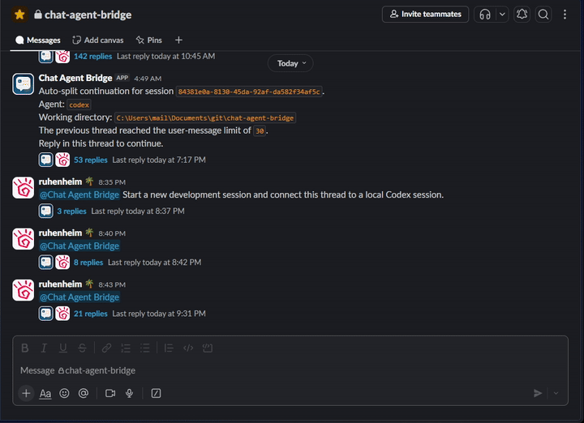
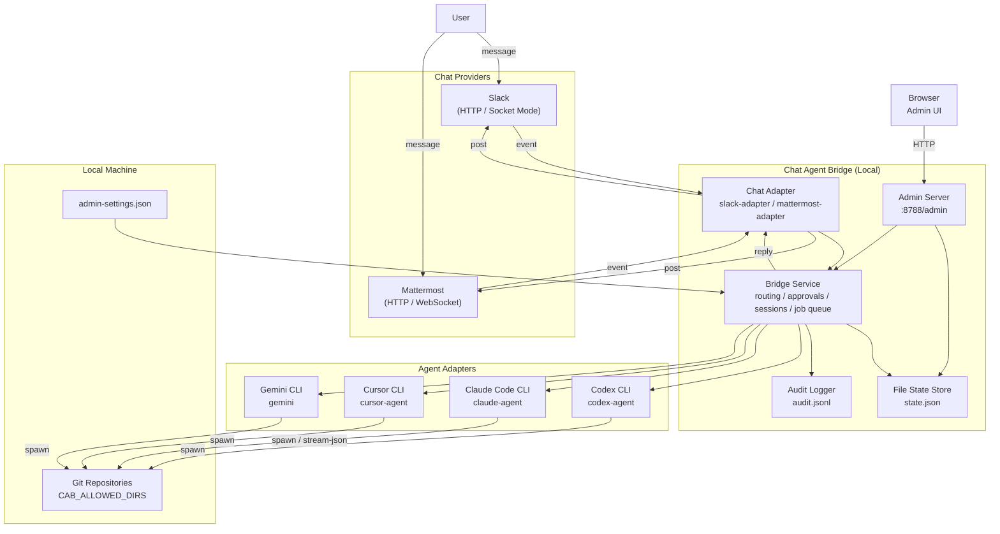

# Chat Agent Bridge

- Languages: [English](README.md) / [Japanese](README.ja.md)

Chat Agent Bridge is a local bridge service that lets you continue operating a development agent from chat threads while preserving local machine context.

## Project status

This project is an unofficial personal tool intended for individual development workflows until official remote-control session support becomes available in upstream products.

It is designed for local, self-hosted use on a machine you control. It is not an official OpenAI, Anthropic, Slack, Mattermost, Cursor, or Google product.

The current implementation is Windows-first and is developed and validated primarily on Windows with PowerShell.

## What it does

- Binds a chat thread to a local agent session
- Keeps local repository context, uncommitted work, and tool state on the same machine
- Supports Slack and Mattermost chat adapters
- Supports Codex, Claude Code, Cursor, and Gemini CLI agent adapters
- Adds approvals, audit logging, repo targeting, and an admin surface
- Supports Mattermost `bot` mode and `self` mode

## Quick start

The commands below assume a Windows environment with PowerShell.

This bridge assumes the local CLI for the selected agent is already installed and authenticated on the same machine before you use it from chat. The bridge does not perform interactive login flows for Codex, Claude Code, Cursor, or Gemini on your behalf.

1. Install dependencies:

```powershell
npm install
npm run check
```

2. Set the minimum environment:

```powershell
$env:CAB_ALLOWED_DIRS="$env:USERPROFILE\Documents\git"
$env:CAB_DEFAULT_WORKDIR="$env:USERPROFILE\Documents\git\chat-agent-bridge"
```

3. Start the bridge:

```powershell
npm run dev
```

Demo: send `@Chat Agent Bridge status` from a connected chat thread.

Or run it as a detached service:

```powershell
npm run service:start
npm run service:status
```

## Demo

Slack example:



## Common service commands

```powershell
npm run service:start
npm run service:status
npm run service:restart
npm run service:restart:build
npm run service:stop
```

## Architecture



## Documentation

- Install and base configuration: [docs/install.md](docs/install.md)
- Slack setup: [docs/slack-setup.md](docs/slack-setup.md)
- Mattermost setup: [docs/mattermost-setup.md](docs/mattermost-setup.md)
- Operations and service management: [docs/operations.md](docs/operations.md)
- Testing and E2E flows: [docs/testing.md](docs/testing.md)
- Architecture: [docs/architecture.md](docs/architecture.md)

## Notes

- The bridge starts an admin server by default on `http://<bridge-host>:8788/admin`
- Initial setup can be guided from `http://<bridge-host>:8788/admin/onboarding`
- Before using any agent through the bridge, verify that the corresponding local CLI can already run successfully in the same environment in non-interactive mode
- Codex sessions use the locally installed `codex` CLI and can reuse an existing local login
- Claude Code is expected to be installed and authenticated locally before bridge execution
- Cursor uses `cursor-agent --trust` by default and exposes a separate model setting in the Admin UI. The default model is `Auto`.
- Cursor is expected to be installed and authenticated locally before bridge execution
- Gemini uses `gemini --approval-mode yolo` by default and exposes separate command and model settings in the Admin UI.
- Gemini is expected to be installed and authenticated locally before bridge execution
- The bridge injects `CHAT_AGENT_BRIDGE=1` into Codex child processes so external hooks can suppress duplicate notifications
- In Mattermost, `MATTERMOST_ACTOR_MODE=self` is intended for user-token operation, accepts only self-DMs, and still requires a mention in that self-DM

## Disclaimer

- This tool is provided as-is, with no warranty of any kind.
- The author does not guarantee stability, correctness, security, or fitness for any purpose.
- Use of this tool is entirely at your own risk.
- The author is not responsible for any data loss, repository damage, account issues, service disruption, security incidents, costs, or any other trouble caused by using this project.
- This bridge can trigger local agent actions against real files, repositories, and connected chat systems. Review the configuration carefully before using it.
- Restrict allowed directories, tokens, network access, and chat exposure to the minimum required for your environment.
- Do not use this project in environments where you cannot accept the operational and security risks of remote-triggered local execution.
