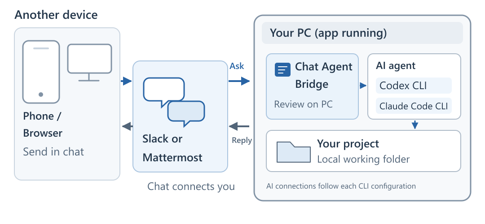
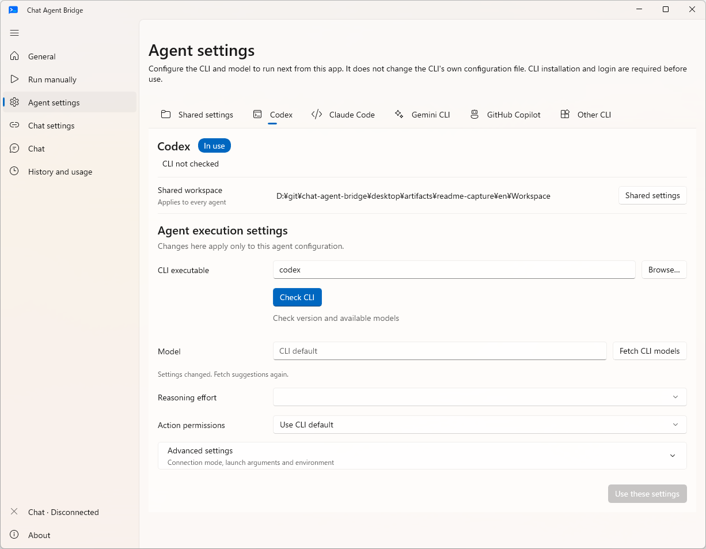
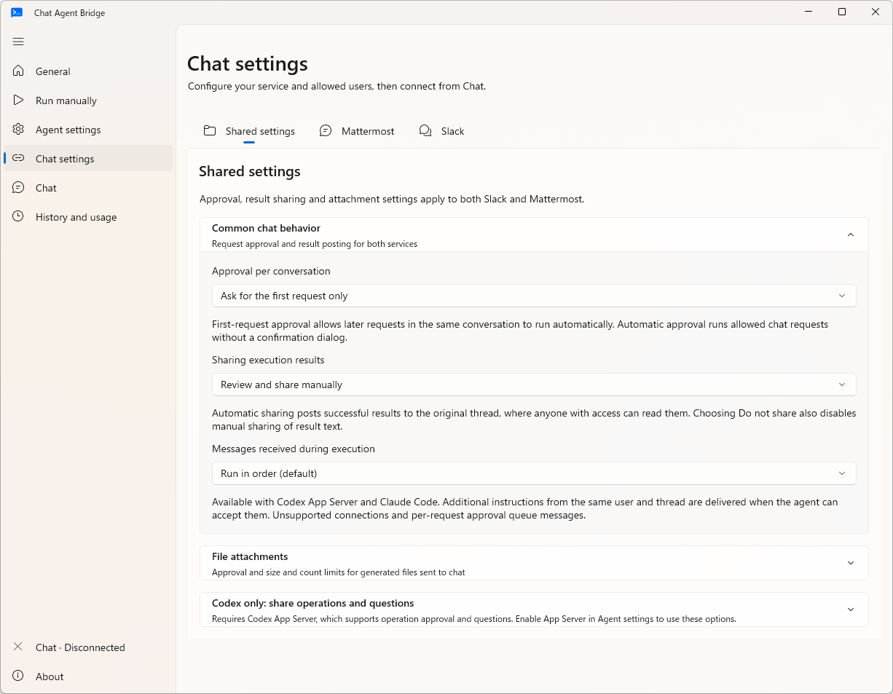
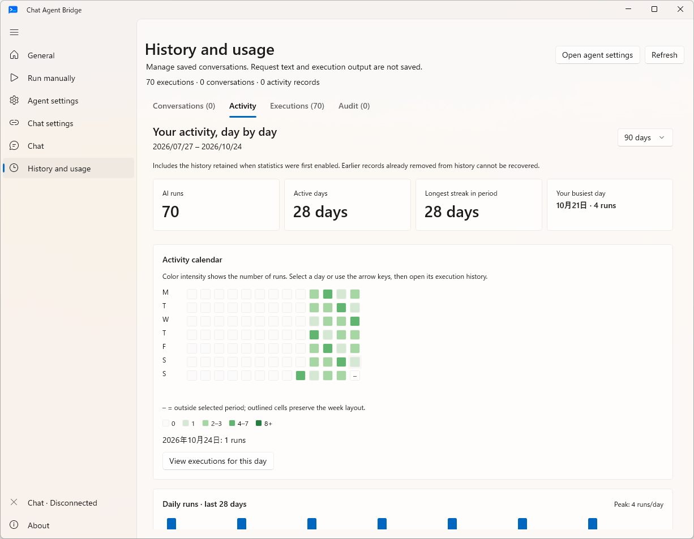
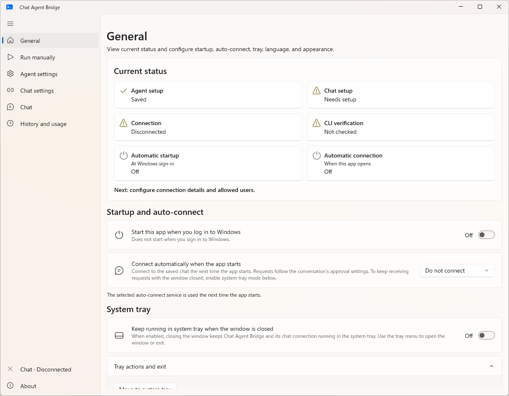

# Chat Agent Bridge

**English** · [日本語](README.ja.md) · [Download](https://github.com/mmiyaji/chat-agent-bridge/releases)

Chat Agent Bridge is a Windows app that accepts requests from Slack or Mattermost and runs AI agents on your PC. You can send requests from a phone or another computer, review results and add instructions in the same thread.

It is intended for devices where you cannot use the Codex or Claude Code desktop app. Bridge starts a command-line agent (CLI) installed on your Windows PC and runs the request in the working folder you selected.

> Prefer the agent provider's official remote-control features when they are available to you. Chat Agent Bridge is developed as an alternative for environments where those official features cannot be used.

## System overview and request flow

This is the diagram shown in the app's setup guide and General page. It uses Codex and Claude Code as examples. Gemini CLI and GitHub Copilot CLI use the same arrangement.

1. **Post from another device** in Slack or Mattermost. That device does not need an agent CLI installed.
2. **Bridge on the Windows PC** receives the post and checks allowed users and conversation approval settings. Requests that need approval wait for a decision on the PC.
3. **The selected CLI** runs the request in the configured working folder. It connects to AI services according to its own settings and performs file operations or commands.
4. **Share the result in the original thread.** By default, you review it on the PC before sending it; automatic replies are also available. Replies from the same user in that thread continue the conversation on supported CLIs.

Keep the Windows PC running with Bridge connected to chat. It can run in the system tray, but cannot process requests while the PC is asleep or signed out.

## Main features

| Feature | Description |
| --- | --- |
| Chat requests | Slack and Mattermost requests with thread-based conversation continuation |
| Agent and model changes | Change them from the PC or chat; choose whether to pass conversation notes when switching agents |
| Progress and cancellation | Chat progress posts, live output on the PC and request cancellation |
| Additional instructions | Queue messages or add them to a running request on supported agents |
| Access restrictions | Allowed users, channels, threads and trusted working folders |
| Approval and sharing | Request approvals, result sharing, attachment approvals and upload limits |
| History and usage | Conversation management, execution and operation history, an activity calendar, and token, cache and estimated-cost charts |
| Startup and appearance | Setup wizard, startup and auto-connect, system tray mode, English/Japanese and light/dark appearance |

## Installation and setup

Portable builds are available for Windows. The app does not require administrator rights or a separate .NET runtime installation. Install and authenticate your chosen CLI and prepare the chat bot separately.

1. Download the **x64 / ARM64** ZIP for your PC from [GitHub Releases](https://github.com/mmiyaji/chat-agent-bridge/releases).
2. Extract the entire folder to a writable location and run `ChatAgentBridge.Desktop.exe`.
3. Install the CLI and sign in through it. Select the CLI and working folder in the setup guide, then run the CLI check.
4. In **Chat settings**, configure connection details and allowed users. Slack requires an app with the necessary permissions; Mattermost requires a bot token.
5. Connect from **Chat**, then mention the bot to send a request. In Mattermost, you can also start with `!cab <your request>`.
6. Approve the first request on the PC. After execution, review and share the result. Reply in the same thread to continue.

Defaults require approval for the first request in a conversation, manual result sharing and approval for every attachment. The CLI check identifies the CLI and version. Check authentication and available quota through the CLI itself.

## Supported agents

The working folder and trusted locations are shared settings. Configure the executable and model separately for each agent. You can also select the CLI executable with a file picker.

| Agent | Conversation continuation | Model settings |
| --- | --- | --- |
| Codex / Claude Code | Supported | Select CLI-provided model and supported reasoning-effort candidates |
| Gemini CLI / GitHub Copilot CLI | Supported | Enter a model name; reasoning settings remain CLI-managed |
| Other CLI | Independent execution for each request | Configure the CLI or its launch arguments |

Change a conversation's agent or model from its details on the PC or from chat. Agent switching uses CLIs checked and registered in the app. You choose whether to pass conversation notes to the new agent.

Codex App Server and Claude Code also support adding instructions to running requests. This applies to posts from the same user in the same thread. Other connections and per-request approval settings queue messages.

See the [per-CLI support guide (Japanese)](desktop/README.ja.md#利用できるcli) for version and authentication requirements. Some Gemini live-service checks remain incomplete because of authentication-environment restrictions.

Agent settings screenshot

## Approvals, access and sharing

**Chat settings** contains approval and sharing rules common to both services, along with each service's connection details and allowed users.

- **Request approval** can be required every time, only for the first request, or handled automatically. This approval starts the request; the CLI's permission to perform individual operations is configured separately.
- **Access restrictions** specify who and which conversations can send requests. Register folders where requests may start as trusted working folders. Changing the folder from chat requires a location within that scope and approval on the PC.
- **Result sharing** can be manual, automatic or disabled. Sent content is visible to everyone who can access the destination chat or thread.
- **Generated file attachments** require approval each time by default. You can instead require approval only for the first attachment in a thread, allow automatic attachments or prohibit attachments. Set per-file size, total size and file count limits.

## Chat commands

After starting a request, reply in the same thread. Actions are scoped to the requester and conversation.

| Command | Purpose |
| --- | --- |
| `!cab command` | List available commands |
| `!cab status` / `!cab stop` | Check or stop your requests |
| `!cab model` | View the current model and how to change it |
| `!cab agent` | List registered agents and switching options |
| `!cab folder "C:\Projects\MyApp"` | Request a working-folder change |

On the PC, you can inspect live output and stop a request. In Mattermost, the requester can also click the 🛑 reaction on the bot's progress post to cancel it. Stopping does not undo file changes already made.

## History and usage

Find saved conversations by name or working folder and change their model or agent. Review execution times, statuses, operation records and usage recorded by this app.

Usage is shown by day and model. Token and cache figures use CLI-reported values; missing values remain unknown. Estimated costs use public pricing and are reference values, not bills or subscription quotas. Price tables can update automatically, with manual overrides taking priority over downloaded prices.

## Appearance, startup and updates

The app uses Japanese when the Windows language preference is Japanese and English otherwise. You can override the language in the app. Choose light, dark or system appearance.

**General** contains Windows sign-in startup, app auto-connect and system tray preferences. You can also choose whether closing the window moves it to the tray or exits the app.

Portable builds can check for and apply updates from **About**. Settings and history are stored in the adjacent `Data` folder and retained during updates. For manual updates, close the app and keep `Data`. Moving to another PC requires reconfiguring chat tokens and CLI authentication.

Screenshots show the development build on a Windows PC on October 24, 2026, using dedicated demo settings and sample usage records. They contain no real conversations or credentials. This README shows light mode; the Japanese version shows dark mode. Released versions may differ.

## Project and documentation

This is an unofficial development preview for personal workflows, not an official OpenAI, Anthropic, Google, GitHub, Slack or Mattermost app. Check the settings and terms of the chat and AI services you use.

- [Terms of Use](docs/terms.en.md) / [Privacy Policy](docs/privacy-policy.en.md)
- [Windows app guide and development instructions (Japanese)](desktop/README.ja.md)
- [Portable edition guide](desktop/distribution/README.portable.en.txt)
- [Report a bug or suggest a feature](https://github.com/mmiyaji/chat-agent-bridge/issues)
- [Third-party notices](desktop/THIRD-PARTY-NOTICES.txt), also available in the app's About page

Documentation for the earlier TypeScript implementation remains in the [installation guide](docs/install.md) and [architecture guide](docs/architecture.md). Those instructions differ from the current Windows app.
