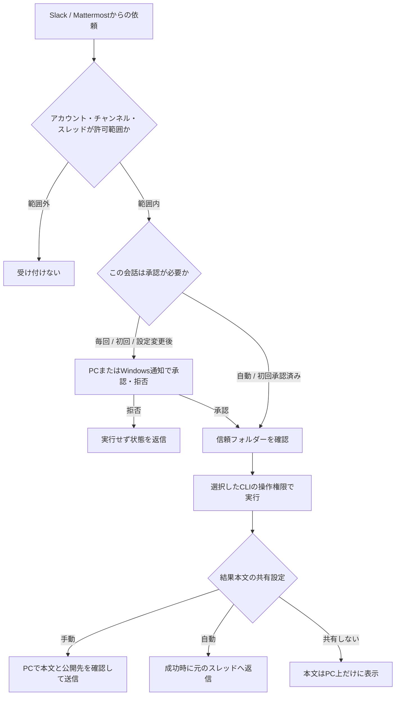

# 実行モードの選び方（WinUI版）

「依頼そのものを実行してよいか」と「実行中のAIに何を許すか」は別に設定します。

## どこで設定するか

- **エージェント設定**：初期作業フォルダー、信頼フォルダー、AIの操作権限、会話の承認、結果の共有。図解と現在の設定の要約もここにあります。
- **接続設定**：許可アカウントを登録します。**エージェント設定 → チャットのアカウント・会話範囲**でSlackのチャンネル、Slack/MattermostのスレッドIDを限定します。アカウントは空欄なら全員拒否、チャンネル・スレッドは空欄なら追加制限なしです。条件はすべて同時に満たす必要があります。
- **履歴と会話 → 会話の実行ポリシー**：そのユーザーのそのスレッドだけに、承認・結果共有・操作権限を上書き。「全体設定を使う」で解除できます。

全体設定を変更したら保存後にチャットを切断・再接続してください。古い設定で受けた保留依頼は実行せず、再投稿が必要です。会話ごとの変更は次の実行時に読み直します。

## チャットから作業フォルダーを変更する

許可済みユーザーが許可されたチャンネル・スレッドで `!cab folder C:\Projects\app` を送ると、その会話の作業フォルダーを変更できます。空白を含むパスは `!cab folder "C:\Projects\my app"` のように引用符で囲みます。Slackの新規スレッドでは、最初にBotへのメンションを付けて `@Chat Agent Bridge folder C:\Projects\app` と送ります。既存スレッドでは `!cab folder ...` を使えます。コマンドは1行目に書いてください。コマンドは対象のプロバイダー・サーバー・ユーザー・チャンネル・スレッドを照合して処理し、CLIやモデルを呼び出しません。変更には毎回、PCの画面またはWindows通知での承認が必要です。会話の承認が自動でも、この確認は省略されません。

指定先は信頼フォルダーの配下でなければなりません。信頼フォルダーが空のときはエージェント設定の初期作業フォルダーだけを暗黙の信頼範囲とします。兄弟フォルダーを指定する場合は、PC上でその親フォルダーを明示的に信頼フォルダーへ追加してください。チャットから信頼範囲を追加・拡張することはできません。

変更内容はアプリ再起動後も保持します。変更した会話に保存されたCLIセッション関連付け、会話別のモデル・推論強度・実行ポリシー上書き、および初回承認記録を解除し、次のメッセージを既定CLIの新しい会話として実行します。全体の承認設定は引き続き適用します。実行履歴は保持し、他のユーザーやスレッドには影響しません。同じ会話の待機中依頼は無効になり、再投稿が必要です。

エージェント設定で全体の初期作業フォルダーを変更すると、新しい会話に適用されます。以前のフォルダーで保存済みセッションを持つ会話は、必要に応じてその会話で `!cab folder` を使って切り替えてください。既存セッションが自動で新しいフォルダーへ移るわけではありません。

## 会話の承認

| 設定 | 動き |
|---|---|
| 毎回確認 | 依頼ごとにPCかWindows通知で承認します。 |
| 最初だけ確認（初期値） | 最初の成功した実行の承認を、ユーザー・接続先・チャンネル・スレッドと実行設定に結び付けて保存します。アプリ再起動後も有効です。 |
| 自動承認 | 許可範囲の依頼を順に実行します。会話の確認ダイアログは出しません。 |

「最初だけ確認」でも、CLI・モデル・作業先・操作権限・共有設定・接続の認証情報などが変わると改めて確認します。会話の実行ポリシーを保存し直すと、初回承認の記録も解除されます。別ユーザーや別スレッドへ承認を流用しません。

新規設定と承認方法が未設定の場合は「最初だけ確認」を使います。保存済みの「毎回確認」「自動承認」や会話別の指定は変更しません。

会話の自動承認は、AIの操作権限を広げません。たとえば「会話は自動、AI操作は都度確認」という組み合わせもCodex App Serverで設定できます。

## AIの操作権限

| 選択 | Codex | Claude Code |
|---|---|---|
| CLI既定（初期値） | CLI設定に従います。App Serverでは従来のフォルダー内書込・操作確認・ツールネットワーク無効です。 | CLIの既存設定に従います。 |
| 読み取り・計画のみ | 読み取り用サンドボックス。 | `plan` モード。OSによる読み取り専用の隔離ではありません。 |
| フォルダー内の編集を自動許可 | ワークスペース書込用サンドボックスで、追加操作の承認を要求しません。範囲外の操作は制約されます。 | `acceptEdits`。ファイル編集の許可を省略します。その他のツールはCLIのルールに従い、拒否される場合があります。 |
| フルアクセス | サンドボックス・CLI操作確認を制限しない設定です。 | `bypassPermissions` でCLIの許可確認を省略します。 |
| 操作ごとに確認 | **App Serverモードのみ**。PC／Windows通知で操作に回答します。 | このブリッジでは未対応です。印刷モードの対話的な許可応答を実装していないため選べません。 |

フルアクセスでも、ブリッジのアカウント・会話制限や会話の承認設定は残ります。「その他のCLI」の操作権限はCLI既定だけです。CLIや組織側の制限が優先される場合があり、アプリが権限を保証・追加するものではありません。

Codexのツールネットワーク設定は、ワークスペース書込／操作確認モードで使います。モデルAPIへの接続を遮断する設定ではありません。フルアクセスでは制限せず、Claude Codeのネットワークはこのアプリから制御しません。

## フォルダーと結果共有

信頼フォルダーを指定すると、その配下の作業フォルダーだけを起点に実行します。空欄では設定した初期作業フォルダーを信頼します。親フォルダー名の部分一致や、外へ抜けるジャンクションを許可しません。この判定は実行の起点の確認で、プロセス全体のファイルアクセスを隔離する機能ではありません。

結果は「手動共有」「成功時に自動返信」「共有しない」から選べます。自動返信も元のスレッドへの投稿なので、**依頼者だけでなくスレッドの閲覧者全員**に見えます。自動返信は成功時の最終メッセージを最大4,000文字まで送り、失敗時のエラー本文は自動送信しません。「共有しない」では手動送信も無効です。本文を共有しなくても完了・失敗などの状態は通知します。

操作承認の詳細をチャットへ公開する設定は、結果本文の共有とは別です。初期値はPC内だけです。

## 組み合わせの例

| 使い方 | 会話承認 | AI操作 | 結果共有 |
|---|---|---|---|
| 内容を確認しながら使う | 毎回 | CLI既定、またはCodex App Serverで操作確認 | 手動 |
| 自分専用スレッドで作業を続ける | 最初だけ | 編集の自動許可 | 手動または自動 |
| 限定したスレッドで定型依頼を受ける | 自動 | 読み取り・計画のみ | 自動 |

いずれも先に許可ユーザーを登録し、必要ならチャンネル・スレッドを限定してください。CLIのログインはSlackのログインと別に必要です。
