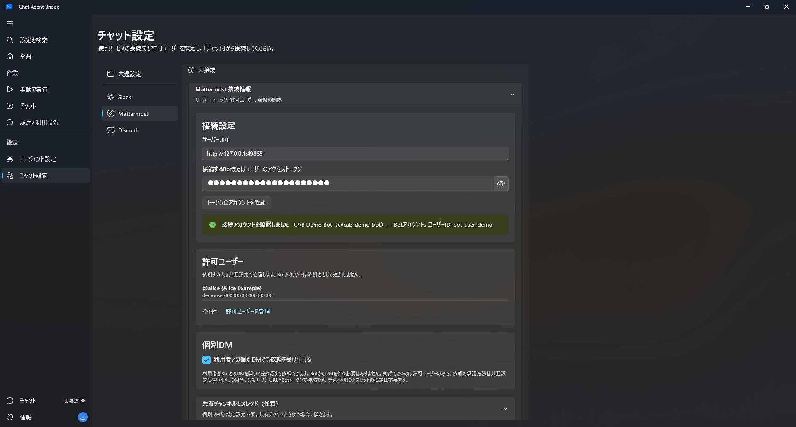
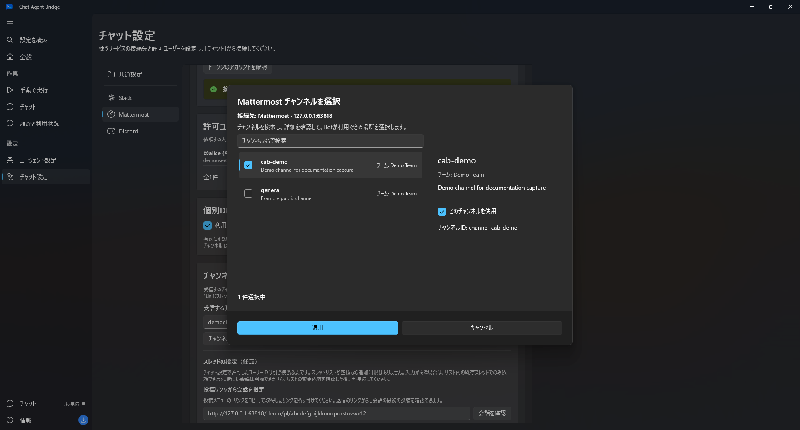
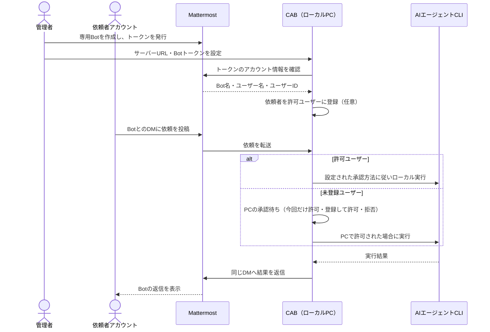
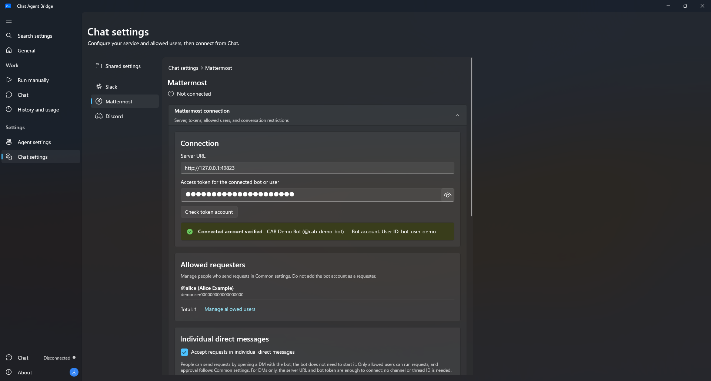
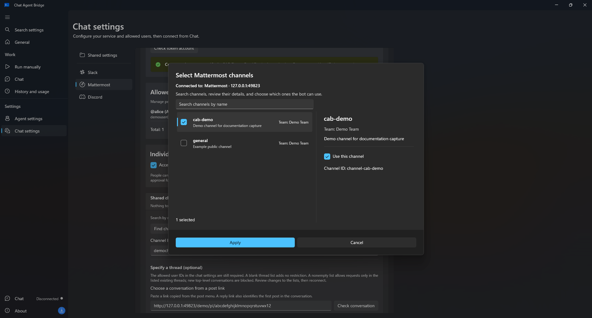
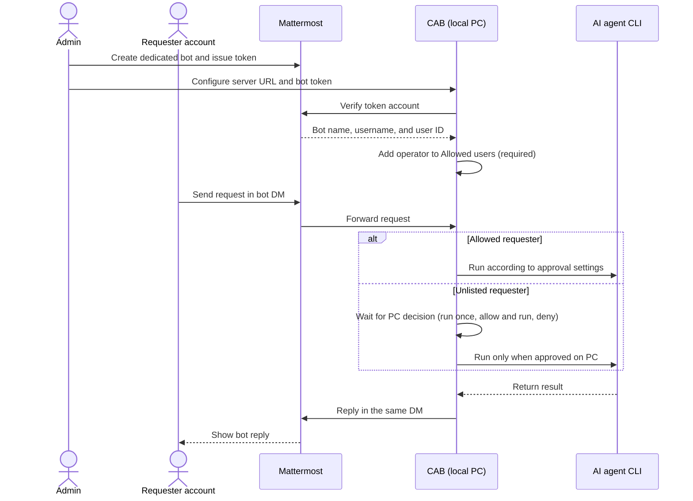

# Mattermost setup / Mattermostの設定

Chat Agent BridgeのWindowsアプリをMattermostへ接続する手順です。

## 全体の流れ

| ステップ | 担当 | 操作 |
| --- | --- | --- |
| 1. Botを準備 | Mattermost管理者 | CAB専用Botアカウントを作成し、アクセストークンを発行する |
| 2. 接続先を確認 | CABを設定する人 | CABにサーバーURLとトークンを入力し、「トークンのアカウントを確認」でBot名・ユーザー名・IDを確認する |
| 3. 依頼者を登録 | CABを設定する人 | 少なくとも自分のMattermostユーザーを「許可ユーザー」に追加する。Bot自身は依頼者として登録しない。未登録ユーザーの明示的な依頼はPCで承認できる |
| 4. 受付場所を選ぶ | CABを設定する人 | 個別DM（推奨）を有効にする。共有チャンネルも使う場合はBotを参加させ、そのチャンネルを選ぶ |
| 5. 依頼して結果を受け取る | 依頼者 | BotとのDMに依頼を投稿する。CABがローカルPCのCLIエージェントを実行し、同じ会話へ結果を返す |

BotはMattermost上でCABが接続・返信に使う専用アカウントです。依頼者は自分の通常アカウントを使います。許可ユーザーはPC承認なしで実行できる利用者を指定します。許可ユーザー以外からの明示的な依頼も、許可された会話範囲内ならPCの承認待ちとして表示でき、「今回だけ実行」「許可して実行」「拒否」を選べます。CABはBotトークンでMattermostのREST APIとWebSocketへ接続し、AIエージェントCLIはローカルPC上で別の認証を使って動作します。

### 設定画面の見かた

Mattermostの設定は、**接続設定 → 許可ユーザー → 個別DM → 共有チャンネルとスレッド（任意） → その他の接続設定** のカードに分かれています。許可ユーザーの一覧は共通設定が本体で、この画面には名前とIDの確認用プレビューが表示されます。

新しい設定では個別DMの受付がオンです。保存済みの設定はその値を引き継ぐため、既存環境ではチェック状態を確認してください。DMだけで使う場合は、サーバーURL・Botトークンと許可ユーザーを設定すればよく、チャンネルIDやスレッドの指定は不要です。共有チャンネルを使う場合だけ、折りたたまれた **共有チャンネルとスレッド（任意）** を開き、チャンネル検索からBotが参加するチャンネルを選びます。

共有チャンネルは名前で検索し、一覧のチェックボックスで選択します。詳細ペインでチーム・説明・チャンネルIDを確認してから適用できます。特定の会話だけを受け付ける場合は、チャンネルの選択後にスレッドの投稿リンクを指定します。この制限は共有チャンネル内に適用します。個別DMには、DMの受付設定、許可ユーザー、承認方法が適用されます。

画像は隔離したテストデータで撮影しています。トークンはマスクし、接続先はローカルのテストサーバー、ユーザー名とチャンネル名はサンプルです。

## Botを準備する

Bridgeは起動中のPCからMattermostのREST APIとWebSocketへ接続します。公開URLやポート開放は不要です。通信障害時は自動再接続を試みますが、切断中の投稿は後から取り込まれないため、接続状態を確認し、届かなかった依頼を再投稿してください。アプリを閉じると受信と実行は停止します。

1. システム管理者が **System Console → Integrations → Bot Accounts** で、Botアカウントの作成を有効にします。
2. **Integrations → Bot Accounts → Add Bot Account** でBot（例: `cc-agent-bot`）を作成し、アクセストークンを控えます。
3. 依頼の受付方法を決めます。
   - **利用者ごとのDM（推奨）**：利用者がMattermostでBotとのDMを開き、最初のメッセージを送ります。MattermostがDM用のチャンネルを作成するため、Botが先にDMを作る必要はありません。
   - **共有チャンネル**：Botを追加したチャンネルで依頼を受け付けます。
4. 共有チャンネル方式の場合は、そのチャンネルのIDを控えます。チャンネル名のメニューの **View Info** などで確認できます。DMのみの場合、チャンネルIDは不要です。

共有チャンネル方式では、設定した1つの会話だけを監視します。DM方式ではBotが参加する個別DMを判別します。許可ユーザーの依頼は設定された承認方法に従い、未登録ユーザーの明示的な依頼はPCの承認待ちとして表示できます。トークンはパスワードに相当するため、チャットやスクリーンショットで共有しないでください。

## CABで設定する

1. **チャット設定 → Mattermost** にサーバーURLとBotトークンを入力し、**トークンのアカウントを確認** を押します。CABに表示されたアカウントが専用Botであることを確認してください。ユーザーアカウントのトークンでも接続できる場合がありますが、専用Botアカウントを推奨します。
2. **ユーザー名から許可するユーザーを検索** に、PC承認なしで依頼できるようにする本人のユーザー名（例: `@alice`）を入力し、検索結果を確認して追加します。表示名やBot名ではありません。許可リストにはMattermost内部のユーザーIDが保存されます。登録しない場合でも、許可された会話範囲内の明示的な依頼はPCに承認待ちとして表示できます。
3. **利用者との個別DMでも依頼を受け付ける** は新しい設定でオンです。保存済み設定では現在のチェック状態を確認してください。利用者がBotとのDMを開いて最初の投稿をすれば、MattermostがDMチャンネルを作成します。Botが先にDMを作る必要はありません。共有チャンネルも使う場合は、任意設定を開いてBotが参加するチャンネルを検索・選択します。DMのみならチャンネルIDとスレッドの指定は不要です。
4. 保存し、**チャット** からMattermostに接続します。依頼者はDMに通常の文章で依頼を投稿できます。共有チャンネルでは `@Bot名` または `!cab` で開始します。必要に応じて **投稿リンクから会話を指定** でスレッドを限定します。

### プロキシを使わず直接接続する

社内ネットワークなどでシステムのプロキシ経由では接続できない場合は、**プロキシを使わず直接接続** をオンにし、**設定を保存 → 切断 → Mattermostに接続** の順に操作します。初期設定ガイドのサーバーURLの下にも同じ項目があります。既定はオフで、システムのプロキシ設定を使います。

この設定は、MattermostのREST認証・ユーザー検索・投稿リンクの確認・返信・接続通知・WebSocketに適用されます。SlackやCLIのプロキシ設定には影響しません。それでも接続できない場合は、名前解決・経路（VPN）・サーバーの稼働状況・TLS証明書の信頼を確認してください。透過型のゲートウェイや接続を検査する端末エージェントは、この設定では回避できません。HTTPSの証明書検証は常に有効です。

## 依頼と操作

- **開始（個別DM）**：BotとのDMに依頼内容をそのまま投稿します。利用者が先にDMを開いて最初の投稿をすれば会話が始まります。
- **開始（共有チャンネル）**：設定した会話で `@cc-agent-bot 依頼内容`（先頭にBotへのメンション）または `!cab 依頼内容` と投稿します。
- **続き**：同じ本人が元のスレッドへ普通に返信すると、メンションやコマンドなしで会話を続けます。
- **無視される投稿**：開始していないスレッド、他のユーザーからの返信、会話の先頭に置いたコマンドなしの投稿は無視します。
- **状態確認・中断**：同じスレッドで `!cab status` / `!cab stop` を投稿するか、Botの進捗投稿にある🛑リアクションを依頼した本人が押します。
- **承認**：依頼の開始はPCで承認します。Codex App Serverでチャットへの承認共有を有効にすると、CLIの操作を `!cab approve <コード>` / `!cab reject <コード>` で承認できます。

最初の依頼を受け付けた後は、承認待ちの間でもその接続中は返信で続けられます。AIのセッションか承認済みの作業フォルダーが保存された後は、再接続・再起動後も同じ本人が続けられます。何も保存される前に切断した場合は、もう一度メンションか `!cab` で開始してください。

## トラブルシューティング

| 症状 | 確認すること |
| --- | --- |
| 接続できない | サーバーURLが `https://` か。トークンが有効か。プロキシ環境なら直接接続の設定。エラーには接続先・権限・ネットワークの確認を促す内容だけを表示します |
| 投稿に反応しない | DM方式なら個別DM受付が有効か、共有チャンネル方式なら設定したチャンネルIDか。許可ユーザーでなければ、PCに承認待ちとして届いているか |
| 許可ユーザーを追加できない | ユーザー名（`@alice`）で検索しているか。表示名やBot名では見つかりません |
| 返信で続かない | 最初の依頼と同じ本人か。何も保存される前に切断していないか |
| 🛑で中断できない | 依頼した本人が押しているか。Botに投稿へリアクションを付ける権限があるか |

診断のためにエラーや画面を共有する場合は、トークンを含めないでください。

---

## English

This guide connects the Chat Agent Bridge Windows app to Mattermost.

### End-to-end flow

| Step | Owner | Action |
| --- | --- | --- |
| 1. Prepare a bot | Mattermost admin | Create a dedicated CAB bot account and issue its access token. |
| 2. Verify the connection identity | CAB administrator | Enter the server URL and token in CAB, then use **Check token account** to verify the bot name, username, and user ID. |
| 3. Allow requesters | CAB administrator | Add at least your own Mattermost account to **Allowed users**. Do not add the bot as a requester. Explicit requests from unlisted users can be approved on the PC. |
| 4. Choose where requests arrive | CAB administrator | Enable individual DMs (recommended). For shared channels, invite the bot and select the channel. |
| 5. Request and receive results | Requester | Send a request in the bot DM. CAB runs the local CLI agent and replies in the same conversation. |

The bot is the dedicated Mattermost account CAB uses to connect and reply. A requester uses their own regular account. Allowed users can run requests according to the configured approval mode; explicit requests from unlisted users can wait for a PC decision. CAB connects with the bot token over Mattermost's REST API and WebSocket; the AI agent CLI runs locally with separate credentials.

### Reading the settings screen

Mattermost settings are grouped into cards: **Connection → Allowed users → Individual DMs → Shared channel and thread (optional) → Other connection settings**. The shared Allowed users list is the source of truth; this page shows a name-and-ID preview.

Individual-DM intake is on for new settings. Saved configurations retain their current value, so check the checkbox on existing installations. For DM-only use, configure the server URL, bot token and allowed users; no channel ID or thread link is needed. To use a shared channel, expand **Shared channel and thread (optional)** and select a channel the bot has joined from the name search.

Search for a shared channel by name and select it with the checkbox. Review its team, description and channel ID in the details pane before applying. To accept requests in only one conversation, specify a thread post link after selecting the channel.

Screenshots use isolated test data. The token is masked, the server is a local test instance, and user and channel names are examples.

### Prepare the bot

Bridge connects out from the running app to the Mattermost REST API and WebSocket. No public URL or open port is needed. It attempts to reconnect after a connection failure, but posts sent while disconnected are not guaranteed to be delivered later. Check the connection status and repost requests that did not arrive. Closing the app stops receiving and running requests.

1. A system administrator enables bot account creation in **System Console → Integrations → Bot Accounts**.
2. Create a bot (for example `cc-agent-bot`) under **Integrations → Bot Accounts → Add Bot Account** and copy its access token.
3. Choose how requests arrive:
   - **Individual DMs (recommended)**: each user opens a DM with the bot in Mattermost and sends the first message. Mattermost creates a separate DM channel; the bot does not need to create it first.
   - **A shared channel**: use a channel the bot has joined.
4. For a shared channel, copy its channel ID, for example from **View Info** in the channel menu. DM-only mode does not need a channel ID.

Shared-channel mode monitors the one conversation you configure. DM mode detects individual DMs the bot belongs to and can show explicit requests from unlisted users for a PC decision. Tokens are equivalent to passwords; do not share them in chat or screenshots.

### Configure CAB

1. In **Chat settings → Mattermost**, enter the server URL and bot token, then select **Check token account**. Verify that CAB shows the dedicated bot account. A user token may work, but a dedicated bot account is recommended.
2. Search for your own username (for example `@alice`) and add the matching result to **Allowed users**; at least one allowed user is required to connect. Do not add the bot as a requester. CAB stores Mattermost's internal user ID for each allowed user. Explicit requests from unlisted users can still appear for PC approval when they are in an allowed conversation.
3. **Accept requests in individual direct messages** is on for new settings. Check its current value on saved installations. A user can open a DM with the bot and send the first post; Mattermost creates the DM channel, so the bot does not need to create it. To also use a shared channel, invite the bot and select it under the optional shared-channel settings. DM-only mode does not need a channel or thread ID.
4. Save and connect to Mattermost from **Chat**. Requesters can send regular messages in their bot DM. In a shared channel, start with `@botname` or `!cab`. A post link limits requests within the shared channel. Individual DMs follow the DM setting, allowed-user checks and approval policy.

#### Connect without a proxy

If the system proxy prevents connecting (for example on a corporate network), turn on **Connect without a proxy**, then **save settings → disconnect → connect to Mattermost**. The first-run wizard offers the same option below the server URL. It is off by default, using the system proxy settings.

This applies to Mattermost REST authentication, user lookup, post-link checks, replies, connection notices and WebSocket events. Slack and agent CLI proxy settings are unaffected. If direct mode still fails, check name resolution, routing or VPN access, server availability and TLS certificate trust. Direct mode cannot bypass a transparent gateway or an endpoint agent that intercepts connections. HTTPS certificate validation always stays enabled.

### Requests and operations

- **Start (individual DM)**: post your request as a regular message in your DM with the bot. You can create the conversation by messaging the bot first.
- **Start (shared channel)**: in the configured conversation, post `@cc-agent-bot your request` (a leading mention of the bot) or `!cab your request`.
- **Continue**: the same sender replies normally in the original thread, without a mention or command.
- **Ignored posts**: threads that were never started, replies from other users and plain top-level posts without a command are ignored.
- **Status and stop**: post `!cab status` / `!cab stop` in the same thread, or have the original requester click the 🛑 reaction on the bot's progress post.
- **Approvals**: approve the request to start on the PC. With Codex App Server and sharing approvals in chat enabled, approve CLI operations with `!cab approve <code>` / `!cab reject <code>`.

After the first request is received, replies continue the conversation for the current connection, even while approval is pending. Once an AI session or an approved working folder is saved, the same sender can also continue after reconnecting or restarting. If the connection ends before anything is saved, start again with a mention or `!cab`. The app does not retrieve posts missed while Mattermost is disconnected; check connection status and repost if a request did not arrive.

### Troubleshooting

| Symptom | What to check |
| --- | --- |
| Cannot connect | The server URL starts with `https://`, the token is valid, and direct connection is configured on proxied networks. Errors only ask you to check the destination, permissions and network |
| Posts get no response | For DMs, individual-DM intake is enabled; for shared channels, you posted in the configured channel ID's conversation. If the poster is unlisted, check whether the request is waiting for a PC decision |
| Cannot add an allowed user | Search by user name (`@alice`); display names and the bot's name are not found |
| Replies do not continue | The reply comes from the original requester, and the connection did not end before anything was saved |
| 🛑 does not stop the request | The original requester clicked it, and the bot can add reactions to posts |

When sharing errors or screenshots for diagnosis, leave out tokens.
